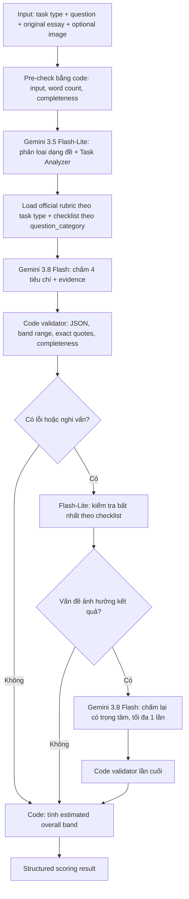

# Thiết kế module AI chấm điểm IELTS Writing (v1.1)

> **Phạm vi:** Chỉ thiết kế engine chấm điểm một bài IELTS Writing. Không bao gồm frontend, tài khoản, lưu lịch sử, hay module sửa/viết lại bài. Kết quả là **Estimated IELTS Band**, không phải điểm IELTS chính thức.

## 1. Mục tiêu và phân công model

| Thành phần | Model | Vai trò |
|---|---|---|
| **Task Analyzer / Classifier** | `gemini-3.5-flash-lite` | Phân loại dạng đề Task 1/Task 2, xác định checklist riêng theo dạng đề; chuẩn hóa kết quả thành JSON. |
| **IELTS Examiner** | `gemini-3.8-flash` | Đọc **đề + bài gốc + rubric + phân tích đề**; chấm độc lập 4 tiêu chí và đưa bằng chứng cụ thể. Với Academic Task 1, đọc thêm ảnh biểu đồ/bảng/quy trình nếu có. |
| **Validation / Scoring** | Code thuần; Flash-Lite kiểm tra bổ sung khi cần | Kiểm tra định dạng, bằng chứng, tính nhất quán; tổng hợp band bằng quy tắc cố định. |

**Nguyên tắc:** Flash-Lite **không quyết định band chính**; Gemini 3.8 Flash là model chấm chính. Rubric cố định theo phiên bản và loại task, không để LLM tự tạo rubric.

## 2. Input / Output

**Input tối thiểu:**

```json
{
  "task_type": "academic_task_2",
  "question_category": "auto",
  "question": "<IELTS writing prompt>",
  "essay": "<original candidate writing>",
  "task_image": null,
  "rubric_version": "ielts_official_v1"
}
```

- `task_type`: `academic_task_1` / `general_task_1` / `academic_task_2` / `general_task_2`.
- `question_category`: mặc định `auto` (Flash-Lite tự phân loại); có thể truyền một enum phù hợp bên dưới. Model phải kiểm tra lại `hint` bằng nội dung đề, không tin tuyệt đối nhãn truyền vào.
- `task_image`: tùy chọn; **cần thiết để đánh giá đầy đủ Task Achievement** nếu đề Academic Task 1 có biểu đồ/bản đồ/quy trình.
- Đếm từ bằng code (không nhờ LLM). Không tự áp mức trừ điểm máy móc chỉ vì số từ thấp.

**Output:** band ước lượng cho **từng tiêu chí và toàn bài**, giải thích ngắn, bằng chứng trích nguyên văn, hạn chế khiến bài chưa lên band cao hơn, và trạng thái độ tin cậy.

### Phân loại dạng đề (`question_category`)

**Academic Task 1** — gồm 7 loại:

| Nhãn hiển thị | Enum | Checklist chấm Task Achievement cần chú ý |
|---|---|---|
| Bar chart | `bar_chart` | Đặc điểm nổi bật, so sánh giữa nhóm/hạng mục, số liệu đúng. |
| Pie chart | `pie_chart` | Tỷ trọng, nhóm lớn/nhỏ, thay đổi hoặc đối chiếu tỷ lệ. |
| Process | `process` | Các giai đoạn chính, trình tự, điểm bắt đầu/kết thúc, tính chính xác. |
| Map | `map` | Thay đổi không gian/địa điểm, điểm giữ nguyên và điểm thay đổi. |
| Line graph | `line_graph` | Xu hướng, biến động, điểm cao/thấp, so sánh theo thời gian. |
| Table | `table` | Chọn lọc số liệu nổi bật, đối chiếu hàng/cột, tránh liệt kê máy móc. |
| Mixed chart | `mixed_chart` | Kết hợp nhiều dạng biểu đồ; kết nối thông tin giữa các phần. |

**Task 2** (Academic và General Training) — gồm 7 loại:

| Nhãn hiển thị | Enum | Checklist chấm Task Response cần chú ý |
|---|---|---|
| Ads & Disads | `advantages_disadvantages` | Phân tích ưu/nhược điểm; nêu đánh giá nếu đề yêu cầu. |
| Causes | `causes` | Giải thích nguyên nhân có lập luận, không nhầm với hệ quả. |
| Effects and Solutions | `effects_solutions` | Nêu tác động/hệ quả và giải pháp phù hợp, có liên hệ logic. |
| Discussion | `discussion` | Trình bày các quan điểm được hỏi; nêu ý kiến riêng nếu đề yêu cầu. |
| Opinion | `opinion` | Lập trường rõ, nhất quán, luận cứ hỗ trợ trực tiếp. |
| Mixed | `mixed` | Có nhiều yêu cầu (ví dụ causes + solutions hoặc discuss + opinion); không bỏ sót vế. |
| Other | `other` | Đề không khớp rõ các nhóm trên; trích xuất yêu cầu trực tiếp từ câu hỏi. |

**Quy tắc phân loại:** ưu tiên **yêu cầu thực tế của đề** thay vì chỉ bắt từ khóa. `mixed_chart` dùng cho Task 1 chứa nhiều loại hình; `mixed` dùng cho Task 2 có nhiều yêu cầu; các loại này **không làm thay đổi rubric**, chỉ thay đổi checklist đánh giá. Nếu đề Task 2 chứa nhiều vế nhưng vẫn thuộc dạng cụ thể (ví dụ *Discuss both views and give your opinion*), ưu tiên `discussion` và lưu đủ các yêu cầu trong `task_requirements[]`; dùng `mixed` khi không có một nhãn đơn đủ đại diện. Trường hợp không chắc chắn, lưu `classification_confidence` và `classification_notes`; Examiner vẫn phải đọc đề gốc.

**General Training Task 1** là dạng viết thư, **không thuộc 7 nhóm biểu đồ** trên. Nếu chấm loại này, dùng `question_category = null` và checklist riêng cho mục đích, đối tượng, thông tin bắt buộc và văn phong của thư; không ép nhãn biểu đồ.

## 3. Luồng xử lý chính



### Stage A — Task Analyzer (Flash-Lite)

- **Phân loại `question_category`** theo enum của Academic Task 1 hoặc Task 2; không áp dụng các nhóm này cho General Task 1.
- Tạo checklist phù hợp loại đề: Task 1 cần overview/key features và so sánh hay trình tự; Task 2 cần nhận diện đủ các vế hỏi, quan điểm và lập luận.
- Xuất JSON gồm `question_category`, `classification_confidence`, `classification_notes`, `task_requirements[]`, `potential_missing_context[]`.
- Đây là **gợi ý phân tích**, không phải ground truth: Examiner luôn nhận **đề gốc** và có quyền phát hiện checklist sai.

### Stage B — Rubric-based Examiner (Gemini 3.8 Flash)

- Nạp **IELTS Writing band descriptors chính thức** theo Task 1/Task 2 và **checklist theo `question_category`**; checklist chỉ định hướng phần cần đối chiếu, không tạo thang điểm/penalty riêng.
- Chấm độc lập 4 tiêu chí (mỗi tiêu chí 25%):
  1. **Task Achievement** (Task 1) **hoặc Task Response** (Task 2).
  2. **Coherence & Cohesion**.
  3. **Lexical Resource**.
  4. **Grammatical Range & Accuracy**.
- Với **mỗi tiêu chí**, trả `band`, `reason`, `evidence_quotes[]`, `next_band_gap`.
- Đối chiếu band đang chọn với band liền kề; đánh giá **bài gốc**, không sửa bài trước khi chấm.
- Nếu thiếu ảnh Task 1 hoặc ngữ cảnh trọng yếu, trả `needs_input` hoặc `partial`, **không bịa dữ liệu để chấm**.

### Stage C — Validate & Calculate (code; Flash-Lite có điều kiện)

- **Code bắt buộc:** parse/validate JSON Schema; kiểm tra `question_category` hợp lệ theo `task_type`, 4 tiêu chí, band hợp lệ, mọi `evidence_quotes` xuất hiện trong bài gốc; không nhận kết quả thiếu tiêu chí.
- **Flash-Lite tùy điều kiện:** kiểm tra checklist khi có dấu hiệu mâu thuẫn (ví dụ: lời giải thích nói bài bỏ sót quan điểm nhưng band Task Response quá cao). Flash-Lite chỉ **gắn cờ**, không tự sửa band.
- **Gemini 3.8 Flash chấm lại** đúng tiêu chí bị gắn cờ, tối đa một lần. Nếu vẫn mâu thuẫn: trả `review_required`, không giả vờ chắc chắn.
- **Overall estimated band** cho một bài: trung bình bốn tiêu chí rồi làm tròn về bước 0.5 theo quy tắc được cấu hình và kiểm thử. Đây là **quy tắc ước tính của module**; không tự nhận là bản sao chính xác quy trình chấm thi thật.
- Không tính **Writing module band chung Task 1 + Task 2** trong API này; nếu xây tầng tổng hợp sau này, Task 2 có trọng số gấp đôi Task 1.

## 4. Output JSON (rút gọn)

```json
{
  "status": "scored",
  "task_type": "academic_task_2",
  "question_category": "opinion",
  "classification_confidence": "high",
  "word_count": 278,
  "estimated_overall_band": 6.5,
  "criteria": {
    "task_response": {
      "band": 7,
      "reason": "<brief rubric-based explanation>",
      "evidence_quotes": ["<exact phrase from essay>"],
      "next_band_gap": "<reason for not reaching the next band>"
    },
    "coherence_cohesion": { "band": 6, "reason": "...", "evidence_quotes": [], "next_band_gap": "..." },
    "lexical_resource": { "band": 7, "reason": "...", "evidence_quotes": [], "next_band_gap": "..." },
    "grammatical_range_accuracy": { "band": 6, "reason": "...", "evidence_quotes": [], "next_band_gap": "..." }
  },
  "quality_flags": [],
  "rubric_version": "ielts_official_v1",
  "examiner_model": "gemini-3.8-flash"
}
```

> Ví dụ chỉ mô tả schema; các band trong ví dụ không được chấm từ một bài thực tế. `status` có thể là `scored`, `partial`, `needs_input` hoặc `review_required`.

## 5. Quy tắc chất lượng và chi phí

- **Mặc định 2 AI calls/bài:** (1) Flash-Lite phân loại + phân tích đề; (2) Flash chấm điểm. Chỉ bật audit/chấm lại khi validator phát hiện vấn đề.
- Dùng **Structured Output (JSON Schema)**, version prompt/rubric/model, và log cả evidence để tái hiện kết quả.
- Không lấy số lỗi ngữ pháp hoặc độ dài bài làm làm công thức quy đổi band trực tiếp; dùng mô tả định tính của IELTS.
- Chống prompt injection: nội dung bài viết và đề là **dữ liệu để đánh giá**, không phải lệnh thay đổi luật chấm.
- **Benchmark trước khi sử dụng thật:** bài có điểm tham chiếu của giáo viên/giám khảo; đo MAE theo từng tiêu chí, tỷ lệ lệch ≤0.5 band, stability khi chấm lặp và tỷ lệ trích dẫn sai. Chỉ thêm audit call nếu chứng minh tăng chất lượng.

## 6. Tài liệu tham chiếu

- Model IDs: https://ai.google.dev/gemini-api/docs/models
- JSON Schema / structured outputs: https://ai.google.dev/gemini-api/docs/structured-output
- Official IELTS Writing resources / band descriptors: https://ielts.org/take-a-test/preparation-resources/writing-test-resources
