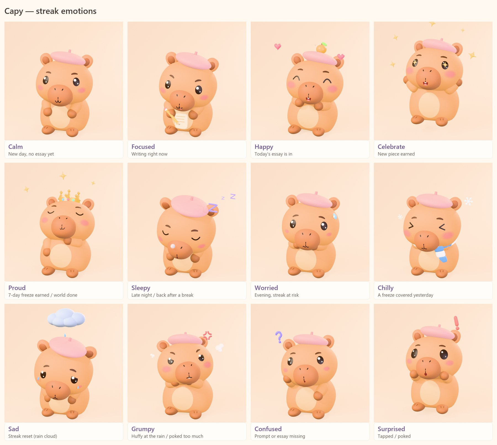
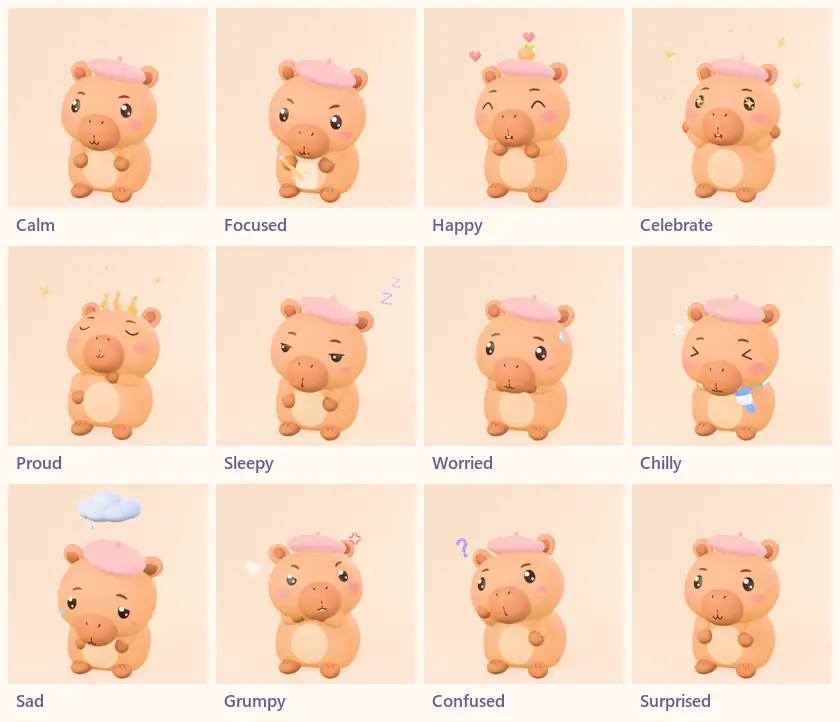
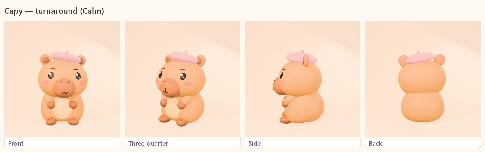
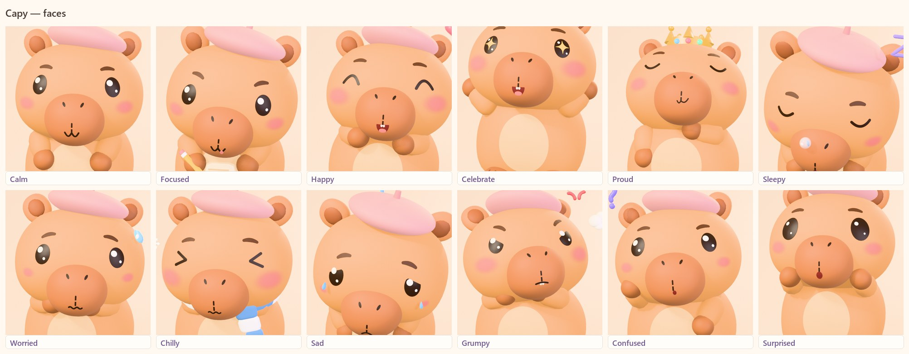
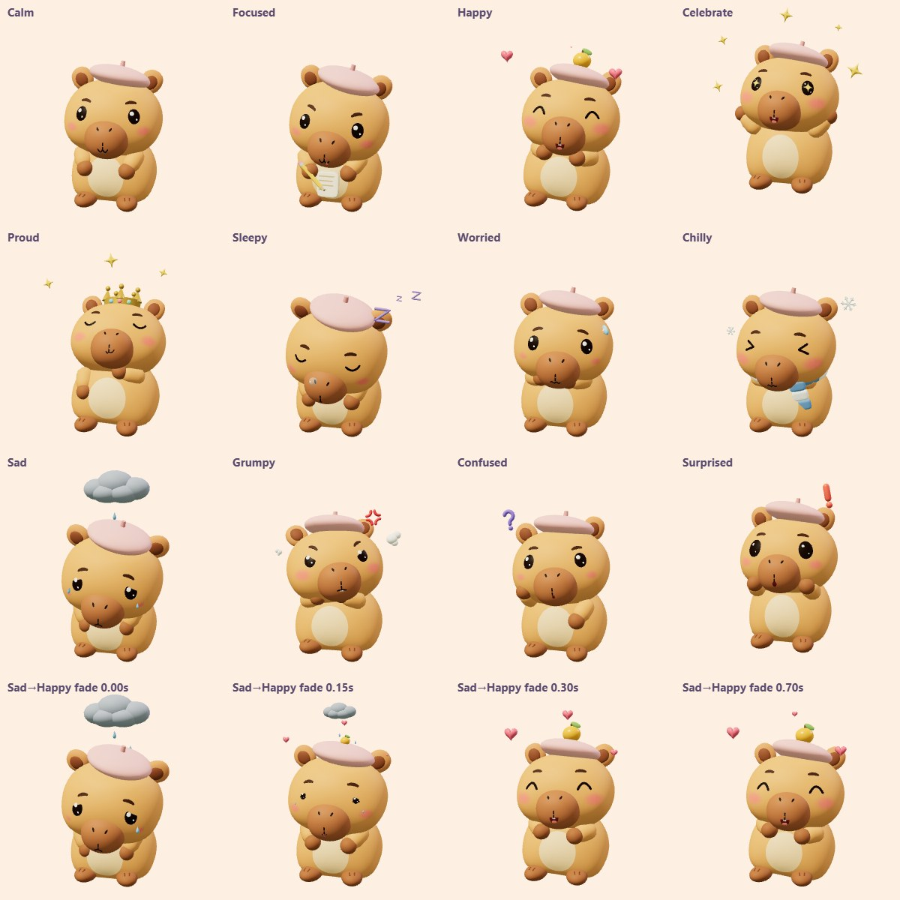

# Capy 3D: mascot cảm xúc cho chuỗi ngày viết

> Một chú capybara 3D hoạt hình có 12 trạng thái cảm xúc. Mỗi trạng thái gắn với một tình huống của chuỗi ngày nộp bài (streak), từ vui vẻ, tập trung, tự hào đến lo lắng, buồn, dỗi và bối rối. Model được dựng hoàn toàn bằng script Python cho Blender 5.3, xuất thành một file GLB cho three.js với 19 clip animation: 12 clip cảm xúc và 7 clip hoạt động trong thế giới (đi, xách bình, xoay, tưới, ngửi, vẫy, nhặt bình).





## 1. Tóm tắt

| Hạng mục | Kết quả |
|---|---|
| Nhân vật | Capybara chibi, đầu chiếm hơn nửa chiều cao (~55%, không tính mũ). Mũ beret "nhà văn", má hồng, mõm nâu. Phong cách toy/clay mịn, sắc nét, không dùng texture (màu theo vertex). |
| Trạng thái | 12: Calm, Focused, Happy, Celebrate, Proud, Sleepy, Worried, Chilly, Sad, Grumpy, Confused, Surprised |
| Hoạt động | 7 clip cho thế giới: Walk, WalkCan, TurnStep, Water, Sniff, Wave, PickUp (mục 5) |
| Biểu cảm | Đổi biến thể bằng cách scale bone: 9 kiểu mắt, 8 kiểu miệng, 33 đạo cụ/ký hiệu (vương miện, bút chì, bình tưới, mây mưa, 💢, Zzz, "?", …) |
| File web | [`public/models/capy.glb`](../../public/models/capy.glb): 810 KB (glTF Transform `dedup` + `meshopt`: EXT_meshopt_compression và KHR_mesh_quantization), 41.972 tam giác trong mesh skin (mỗi trạng thái chỉ hiện 18–21k) cộng 1.304 tam giác của bình tưới tĩnh, 6 material, 77 joint, 19 clip ở 24 fps |
| Nguồn | [`art/capy/`](../../art/capy/): script dựng model, pose, animation, render, export, cùng `capy.blend` đã bake animation |
| Kiểm chứng | QA trong Blender (từng trạng thái), và tải thử trong three.js r180 với đúng renderer và đèn của `Scene.tsx` |
| Trong app | Cảm xúc nằm ở **logo 3D** (đổi theo chuỗi ngày, giờ trong ngày, lúc đang gõ và khi chạm). Trong thế giới, Capy **tự đi lại**: ra vào nhà, tưới cây, ngửi hoa, vẫy khi được chạm (mục 5). Thiết kế đầy đủ: [logo-and-world-behavior.md](logo-and-world-behavior.md) |

## 2. Nghiên cứu → nguyên tắc thiết kế

### 2.1 Mascot và chuỗi ngày: nên và không nên

**Các sản phẩm khác dùng cảm xúc mascot thế nào**

- **Duolingo:**
  - Widget của Duo "ngày càng tuyệt vọng" khi gần nửa đêm và thư thái khi đã học xong [2].
  - Duolingo thừa nhận họ khai thác *loss aversion*, và mất chuỗi thì "khá nản" [1].
  - Cho giữ tối đa 2 streak freeze làm tăng 0,38% số người dùng hằng ngày [1].
- **Mặt tối của mascot gây áp lực:**
  - Chiến dịch "Duo chết" năm 2025 gây phản ứng trái chiều [5][6].
  - Tamagotchi chết vì bị bỏ bê khiến trẻ em đau buồn, nhiều trường cấm đồ chơi này [11].
  - Habitica phạt mất máu, vàng và đồ [8]. Forest cho cây chết nếu thoát app giữa phiên [10].
- **Hướng tha thứ:** Finch dặn người dùng đừng lo khi lỡ một ngày, và cho cách sửa chuỗi [7].

**Bằng chứng nghiên cứu**

- **Hiện chuỗi bị đứt làm giảm động lực về sau.** Mức giảm lớn hơn khi người dùng tự trách mình, và nhỏ hơn khi chuỗi có thể sửa được [12][13].
- **Mục tiêu có "ngày dự phòng" giúp quay lại tốt hơn.** 55% người dùng trở lại sau khi lỡ một ngày, so với 37% khi mục tiêu cứng [14]. Đây chính là cơ chế freeze mà app đang có.
- **Cách nói quan trọng:**
  - Cảm giác tội lỗi vừa phải thuyết phục được, quá mức thì gây bực bội [15].
  - Từ ra lệnh như "must" gây phản kháng [16].
  - Tử tế với bản thân sau thất bại làm tăng động lực sửa sai [17].
  - Mốc thời gian mới như tuần mới, tháng mới tạo động lực "bắt đầu lại" [18].
  - Tránh câu chữ kiểu *confirmshaming* [19].

**Nguyên tắc rút ra cho Capy**

1. **Thưởng cho việc xuất hiện, không chấm điểm.** Cảm xúc của Capy không bao giờ phản ứng theo band IELTS.
2. **Buồn và dỗi chỉ thoáng qua (3–7 giây), mang tính hài hước.** Không chặn thao tác, không lặp kéo dài cả ngày.
3. **Cơn giận nhắm vào đám mây mưa hoặc chuyện bị chọc quá nhiều, không bao giờ nhắm vào người dùng.**
4. **Luôn nói rõ sự thật đi kèm cảm xúc:** "−1 sao, mọi mảnh ghép vẫn còn", số freeze còn lại, hạn chót là nửa đêm giờ Asia/Ho_Chi_Minh.
5. **Tha thứ ngay khi người dùng bắt đầu viết.** Capy chuyển sang Focused, và đám mây không còn trên người Capy.

### 2.2 Vì sao Capy trông đáng yêu

- **Baby schema [22][23]:**
  - Đầu to, mặt tròn, trán cao, mắt to đặt thấp trên mặt.
  - Mũi miệng nhỏ, má phúng phính.
  - Mickey Mouse cũng "trẻ hóa" theo đúng hướng này qua nhiều thập kỷ [24].
- **Điều chỉnh từ capybara thật:**
  - Mắt capybara thật nằm cao trên đầu để bơi [26]. Capy được hạ mắt xuống và phóng to.
  - Mõm dài thật được thu ngắn thành một "đệm" tròn.
- **Tỉ lệ chibi:** đầu chiếm khoảng 1/3 đến 1/2 chiều cao [27]. Capy còn "siêu biến dạng" hơn: đầu chiếm khoảng 55% chiều cao (không tính mũ), để đọc rõ cảm xúc ở kích thước nhỏ.
- **Shape language [28]:** hình tròn gợi cảm giác thân thiện. Toàn thân Capy là khối tròn hình "ổ bánh mì". Hình nhọn chỉ dùng cho ký hiệu 💢.
- **Đọc được ở kích thước ~100 px [31][33]:**
  - Vui và ngạc nhiên vẫn nhận ra từ xa. Buồn và sợ thì cần nhìn gần.
  - Vì vậy các trạng thái buồn, lo, dỗi dựa vào tai, dáng người và ký hiệu đặt quanh đầu, không chỉ vào lông mày.
  - Ký hiệu dễ hiểu nhất khi theo quy ước, đặt cạnh đầu và khớp với nét mặt.
- **Ký hiệu manga [34–36]:**

  | Ký hiệu | Nghĩa |
  |---|---|
  | Giọt mồ hôi | Lo, ngượng |
  | 💢 | Giận |
  | Zzz, bong bóng mũi | Ngủ |
  | Mắt sao | Phấn khích |
  | Nước mắt | Buồn |
  | Phồng má | Dỗi đáng yêu |

- **Chi tiết capybara thật:**
  - Capybara là biểu tượng của sự điềm tĩnh [46].
  - Truyền thống tắm suối nước nóng với quả yuzu ở sở thú Izu Shaboten [45]. Quả yuzu trên mũ Capy khi Happy lấy ý từ đây.
  - Capybara đực nghiến răng khi hung hăng [44]. Vì vậy hai chiếc răng chỉ xuất hiện ở Grumpy, và Chilly dùng miệng run thay vì nghiến răng.
  - Capybara không có đuôi nhìn thấy được, nên mặt sau của Capy để trơn.

### 2.3 Lựa chọn kỹ thuật cho web

- **Biểu cảm bằng bone thay vì shape key:**
  - three.js gom mọi morph target của một mesh vào một track animation. Clip chớp mắt và clip cảm xúc sẽ ghi đè nhau [55].
  - Lõi glTF không có cách animate việc ẩn/hiện. Cách chuẩn là scale bone 0↔1 [57].
  - KHR_node_visibility và KHR_animation_pointer chưa có trong lõi three.js [60–64].
- **Cẩn thận khi scale về 0 [58]:**
  - three.js có lỗi skinned mesh biến mất khi node cha bị scale về 0.
  - Ở đây mỗi đạo cụ có bone riêng, không bao giờ scale node cha của mesh.
  - Nên đặt `frustumCulled = false`.
- **Định dạng nén:**
  - App đang dùng three **r180**. EXT_meshopt_compression chạy được từ r122. KHR_meshopt cần r183 trở lên [59][74][75].
  - Draco không nén animation [78][79].
  - Vì vậy chọn **EXT_meshopt**.
- **Ngân sách tham khảo:**
  - Khronos cho quảng cáo banner 3D: 500 KB, 30k tam giác [72].
  - Google Scene Viewer: lý tưởng 30–50k tam giác [56].
  - Capy: mỗi trạng thái hiện 18–21k tam giác, file 810 KB (19 clip).

## 3. Thiết kế nhân vật





**Tỉ lệ và hình khối**

| Thông số | Giá trị |
|---|---|
| Chiều cao | 1,16 đơn vị (từ chân đến đỉnh mũ, tư thế Calm) |
| Rộng × sâu | 0,80 × 0,85 |
| Hướng mặt | −Y trong Blender, +Z trong three.js |
| Gốc tọa độ | Trên mặt đất, giữa hai chân |

- **Đầu:** khối ellipsoid (0,40 × 0,355 × 0,33), có bướu má và đỉnh đầu hơi phẳng.
- **Mõm:** superellipsoid hơi vuông, mũi là hai khe xếch, miệng hình chữ ω.
- **Thân:** hình quả lê, ngồi bệt. Bụng có mảng lông sáng, tay ngắn đặt trên bụng, bàn chân có rãnh ngón.

**Bảng màu** (sRGB, nằm trong `PAL` của [`capy_build.py`](../../art/capy/capy_build.py))

| Vai trò | Hex | Vai trò | Hex |
|---|---|---|---|
| Lông | `#E8A460` | Lông sáng (bụng) | `#F8D3A3` |
| Mõm | `#B07148` | Bàn chân | `#9E643C` |
| Tai ngoài / trong | `#D9925A` / `#8A5233` | Mắt, nét mực | `#24150B` |
| Lông mày | `#4A2C18` | Má hồng | `#F7837A` |
| Beret | `#F6B8BC` | Vàng (vương miện, sao) | `#F2C14E` |
| Nước mắt / mồ hôi | `#7FC4F2` / `#93D2F5` | 💢 / "!" | `#E5484D` / `#F2665A` |
| Zzz | `#9C8ADE` | "?" | `#8B7BEA` |

**Material**

| Material | Dùng cho | Đặc tính |
|---|---|---|
| `M_Toy` | Phần lớn cơ thể, viền bình tưới (`#F5F8FC`) | Màu theo vertex, độ nhám 0,6 |
| `M_Eye` | Mắt | Bóng vừa |
| `M_Gloss` | Giọt nước, tim, sao, thân, quai và vòi bình tưới (`#6FA3DB`) | Bóng |
| `M_Gold` | Vương miện, hoa sen của bình tưới | Nửa kim loại (metalness 0,5), để vẫn ra màu vàng dưới ánh sáng không có environment map của app |
| `M_Blush` | Má hồng | Texture alpha tròn 64 px |
| `M_Glass` | Bong bóng mũi | Trong suốt |

Mũ beret màu hồng là điểm nhấn màu. Ảnh 2D hiện có trong `public/capy-*.png` dùng beret màu kem; muốn đồng bộ thì chỉ cần đổi một dòng trong `PAL`.

**Đạo cụ gắn với câu chuyện của app**

| Đạo cụ | Ý nghĩa |
|---|---|
| Sổ và bút chì | Đang viết |
| Vương miện | Mảnh ghép "Capy's crown" và cột mốc |
| Yuzu | Vui như đi tắm suối nước nóng |
| Khăn quàng | Được freeze giữ ấm |
| Mây mưa | Cơ chế `rainyUntil` |
| Bình tưới | Chăm cây trong thế giới (`PickUp`, `WalkCan`, `Water`). Bán kính 0,085, cao 0,15, vòi 0,19 chếch 35°, quai ở sau, 1.304 tam giác |

## 4. 12 trạng thái và ánh xạ chuỗi ngày

| Trạng thái | Nét nhận diện | Khi nào (theo `src/model.ts`) | Clip |
|---|---|---|---|
| **Calm** | Mắt tròn chớp chậm, miệng ω, thở nhẹ, tai thỉnh thoảng giật | Chưa viết hôm nay, trước 18:00 | Lặp, 4 s |
| **Focused** | Cúi nhìn sổ, thè lưỡi, tay phải viết, có lúc ngẩng lên suy nghĩ | Đang gõ trong editor (có thay đổi trong 20 s gần nhất) | Lặp, 4 s |
| **Happy** | Mắt ^^, miệng mở, nhún nhảy, tim bay, yuzu trên mũ | `lastRewardDay === today` (đã có bài hôm nay, kể cả bài thứ hai) | Lặp, 3 s |
| **Celebrate** | Mắt sao, hai tay giơ cao, nhảy hai nhịp, tia lấp lánh | Khi đóng hộp thoại phần thưởng sau bài đầu tiên trong ngày (chuỗi tăng), cùng lúc mảnh mới rơi xuống | 2 vòng, 2 s mỗi vòng |
| **Proud** | Nhắm mắt cười mỉm, ngẩng cằm, đội vương miện | Sau Celebrate khi `streak % 7 === 0` (nhận freeze) hoặc hoàn thành world (`complete`) | Lặp, 3 s |
| **Sleepy** | Mắt díp, gật gù, bong bóng mũi, Zzz, có lúc giật mình | Chưa viết, 22:00–05:59 | Lặp, 4 s |
| **Worried** | Lông mày chau lên, miệng lượn sóng, giọt mồ hôi, liếc ngang | Chưa viết, 18:00–21:59 và `streak > 0` | Lặp, 3 s |
| **Chilly** | Mắt >\<, run, khăn quàng, bông tuyết | Lần mở đầu tiên trong ngày sau khi `reconcileProgress` dùng mất một freeze | Một lần (3 s), rồi về trạng thái nền |
| **Sad** | Mắt rưng rưng, nước mắt, tai cụp, mây mưa trên đầu | Lần mở đầu tiên sau khi chuỗi reset (`rainyUntil` vừa được đặt) | Một lần (4 s) |
| **Grumpy** | Lông mày cau, phồng má, khoanh tay, 💢, giậm chân, phì hơi | Ngay sau Sad (dỗi đám mây), hoặc khi bị chạm ≥ 4 lần trong 3 s | Một lần (3 s) |
| **Confused** | Nghiêng đầu, một bên mày nhướn, tay chống má, dấu "?" | Nộp bài thiếu chữ (< 150/250 từ) hoặc form chấm điểm thiếu đề/bài | Một lần (3 s) |
| **Surprised** | Mắt tròn xoe, miệng "o", bật nhảy, dấu "!" | Chạm vào Capy | Một lần (1,5 s) |

**Thứ tự ưu tiên**

1. **Sự kiện một lần.** Mỗi sự kiện phát xong thì quay về trạng thái nền:
   - Chạm → Surprised (chạm dồn dập → Grumpy).
   - Nộp bài được thưởng → Celebrate ×2 → Proud hoặc Happy.
   - Nộp bài bị từ chối → Confused.
   - Dùng mất freeze → Chilly.
   - Chuỗi reset → Sad → Grumpy.
2. **Đang gõ** → Focused. Đây cũng là lúc Capy "tha thứ": chỉ cần bắt đầu viết là hết buồn.
3. **Trạng thái nền**, tính lại mỗi phút:
   - Đã viết hôm nay → Happy.
   - Chưa viết, trước 18:00 → Calm.
   - Chưa viết, 18:00–21:59, đang có chuỗi → Worried.
   - Chưa viết, 22:00–05:59 → Sleepy.

Khi `rainyUntil` còn hiệu lực, thế giới 3D vẫn mưa như hiện nay, nhưng trạng thái nền của Capy không phải Sad. Như vậy Capy không trách móc người dùng suốt hai ngày.

**Gợi ý câu chữ đi kèm** (UI bằng tiếng Anh)

| Trạng thái | Câu gợi ý |
|---|---|
| Worried | "Today's piece is still open until midnight." |
| Chilly | "A freeze covered yesterday. 1 left." |
| Sad | "Rain came: −1 star. Every piece is safe. Write today to clear the sky." |
| Confused | "Task 2 needs 250 words, 38 to go." |

Không dùng "must" hay câu kiểu confirmshaming.

## 5. Tích hợp three.js

**Thông số file:** [`public/models/capy.glb`](../../public/models/capy.glb)

| Thông số | Giá trị |
|---|---|
| Nén | EXT_meshopt_compression và KHR_mesh_quantization (cả hai nằm trong `extensionsRequired`), bắt buộc phải có decoder |
| Mesh | 1 skinned mesh, 6 primitive/material (6 draw call). Thêm bình tưới tĩnh: 3 primitive (`M_Gloss`, `M_Toy`, `M_Gold`) |
| Node gốc | `RIG_Capy` và `WateringCan` |
| Skin | 77 joint, mỗi vertex 1 influence |
| Clip | 19 clip. Mỗi clip có track cho mọi bone (231 channel), nên đổi clip sẽ tự tắt mọi thứ clip trước bật |

**Clip và thời điểm "hero"** (dùng cho chế độ giảm chuyển động)

| Clip | Thời lượng | Hero |
|---|---|---|
| `Calm` | 4 s | 0,10 |
| `Focused` | 4 s | 0,20 |
| `Happy` | 3 s | 0,30 |
| `Celebrate` | 2 s | 0,24 |
| `Proud` | 3 s | 0,30 |
| `Sleepy` | 4 s | 0,60 |
| `Worried` | 3 s | 0,18 |
| `Chilly` | 3 s | 0,30 |
| `Sad` | 4 s | 0,30 |
| `Grumpy` | 3 s | 0,30 |
| `Confused` | 3 s | 0,25 |
| `Surprised` | 1,46 s, một lần | 0,29 |
| `Walk` | 1,5 s (36 khung, 2 bước × 18) | 0 (gót chạm đất) |
| `WalkCan` | 1,5 s | 0 |
| `TurnStep` | 1,5 s (60° mỗi 18 khung) | 0,14 |
| `Water` | 2 s (48 khung, hai nhịp rưới) | 0,30 (nước đang rơi) |
| `Sniff` | 2,46 s, một lần | 0,68 |
| `Wave` | 1,79 s, một lần | 0,51 |
| `PickUp` | 0,96 s, một lần | 1 (tư thế xách) |

**Clip hoạt động** (toạ độ trong không gian của `root` trong three.js, đơn vị model, nhân thêm scale của Capy)

- **Root motion không nằm trong clip:** clip đứng tại chỗ, app tự di chuyển và xoay `root`.
- **`Walk` / `WalkCan`:**
  - Mỗi chu kỳ 18 khung bước 0,40, tức 0,533 đơn vị/s ở timeScale 1. Đi đúng tốc độ này thì chân không trượt (đo được tối đa 0,28 mm/khung).
  - Gót chạm đất ở f0 và f9. Khung lướt qua là 5,08 và 14,08.
  - `WalkCan` dùng chung chân với `Walk`, tay phải giữ bình, tay trái đánh.
- **`TurnStep`:**
  - Ở timeScale 1, `root.rotation.y` phải tăng 80°/s (1,396 rad/s), tức rẽ trái.
  - timeScale −1 là rẽ phải, `rotation.y` giảm. Xoay sai chiều làm chân trượt 35 mm/khung.
- **`Water`:** nước rơi quanh (−0,50; 0,012; 0,68), tức 0,68 về trước và 0,50 sang phải, trải rộng 0,07 × 0,12. Dùng `drop1–3`.
- **`PickUp`:**
  - `can.scale` đổi 0 → 1 ở f10 (0,417 s). Đặt bình tĩnh ở (−0,3375; 0; 0,4459) và ẩn nó đúng lúc này.
  - Lúc cầm, đáy bình nằm ở độ cao 0,017, nên bình nhích lên 1,7 cm. Đây là rủi ro đã chấp nhận ở giới hạn tầm với.
  - `PutDown` là chính clip này chạy ngược. Hiện lại bình tĩnh khi thời gian lùi qua 0,417 s.
  - Khung cuối lệch tư thế `WalkCan` f0 2,3 cm ở bàn tay, nên cần crossfade.
- **`WateringCan`:** node tĩnh, không skin, gốc ở đáy giữa bình.
  - Mesh nằm ở node con `WateringCanMesh`, mang transform giải lượng tử của meshopt, nên đừng reset transform của node con này.
  - Phải gỡ `WateringCan` khỏi mọi bản load hoặc clone. Nếu không, bình sẽ đứng ở gốc tọa độ, giữa hai chân Capy.
- **Tên track của bình:** `can.position`, `can.quaternion`, `can.scale` và `drop1.scale`, … (three.js bỏ dấu chấm trong tên bone).

**Cách app dùng model**

Cảm xúc ở logo, hành động ở thế giới. Thiết kế và các số đo: [logo-and-world-behavior.md](logo-and-world-behavior.md).

| File | Vai trò |
|---|---|
| [`src/capyModel.ts`](../../src/capyModel.ts) | Tải GLB một lần (`GLTFLoader` + `MeshoptDecoder`), clone bằng `SkeletonUtils.clone`, gỡ `WateringCan` khỏi mỗi bản clone. Actor cảm xúc cho logo: `setMood`, `react`, `burst` (một đợt ≤ 5 s rồi dừng êm ở khung hero), `halt`, tuỳ chọn `fx` phóng to ký hiệu nổi |
| [`src/CapyLogo.tsx`](../../src/CapyLogo.tsx) | Logo 3D: một renderer dùng chung cho logo sidebar và topbar, 30 fps khi diễn, không vẽ khi nghỉ. Dự phòng `favicon.svg` khi không có WebGL, WASM, hoặc bật Save-Data |
| [`src/capyMood.ts`](../../src/capyMood.ts) | Hàm thuần `baseMood`, `reconcileSteps`, `entrySteps`, hook `useCapyMood` (hàng đợi bắt đầu khi logo vẽ khung đầu), `capyBus` cho phản ứng tức thời, `nextPokeReaction` đếm chung lượt chạm Capy và bấm logo |
| [`src/capyNav.ts`](../../src/capyNav.ts), [`src/capyNavData.ts`](../../src/capyNavData.ts) | Bản đồ đi được theo số mảnh (lưới A* 0,1, độ cao mặt đất, vùng nhìn thấy từ camera), POI, lối cửa. Thuần, không import three |
| [`src/capyBehavior.ts`](../../src/capyBehavior.ts) | Bộ não: lịch hoạt động có trọng số và hồi chiêu, kịch bản vào/ra nhà, tưới cây, mưa, chạm, mảnh mới, vương miện. Tua clip đi theo quãng đường nên chân không trượt. Thuần, test được hàng nghìn khung hình |
| [`src/capyWorld.ts`](../../src/capyWorld.ts) | Nối bộ não với three.js: clip ghép lúc tải (`Cheer`, `Bounce`, `Write`, `WaveCan`, `PutDown`, biến thể cầm bình), cửa bản lề và khe cửa tối, đèn cửa sổ, khói, cờ hòm thư, bình tưới tĩnh, lấp lánh và cây nảy khi tưới. Trí nhớ vị trí theo thế giới qua các lần dựng lại cảnh |
| [`src/Scene.tsx`](../../src/Scene.tsx) | Dựng thế giới (bố cục mục 4.4 của bản thiết kế), gắn Capy biết đi ở scale 0,85, chuyển chạm vào Capy và gõ cửa nhà |

- **Chạm:** SkinnedMesh không nhận raycast vì rất chậm. Một ellipsoid vô hình (to hơn thân 1,3 lần cho dễ chạm trên điện thoại, `userData.isCapy`) nhận chạm và con trỏ. Khi Capy ở trong nhà kín thì ẩn luôn ellipsoid này, để không chạm xuyên tường. Chạm vào nhà khi Capy ở trong thì Capy ra cửa vẫy.
- **Vương miện:** từ mảnh 20 của Cottage và ở World 2, Capy đội vương miện của GLB thay mũ beret. Khi mảnh 20 đang rơi, Capy đứng chờ ở (−1,90; 1,70), vương miện rơi đúng lên đầu rồi Capy nảy lên.
- **Giảm chuyển động và Collection:** Capy giữ một tư thế đặc trưng tĩnh: trước bậc thềm ở Cottage, cầm bình tưới cạnh gốc cây ở Magic Tree. Khi giảm chuyển động, chạm thì vẫy 1,5 s.
- **World 3 (Lego Capybara):** không đặt Capy, giữ đúng thiết kế cũ.
- **Lần tải đầu:** nếu đã có cửa, Capy bước từ trong nhà ra chào. Nếu không, Capy "bật" vào ở chỗ nghỉ.
- **Dọn dẹp:** mỗi bản clone chỉ dispose skeleton, hitbox và hiệu ứng của nó. Geometry, material và texture được dùng chung qua cache. Mỗi cảnh gọi `forceContextLoss()` khi dọn để không chạm giới hạn 16 WebGL context.
- **Debug:** ở bản dev, phần tử `.scene-render` có thuộc tính `data-capy` mô tả việc Capy đang làm (dùng trong `tests/world.e2e.ts`).

**Lưu ý khi tích hợp**

- Phải phát một clip và gọi `mixer.update(0)` **trước** frame đầu tiên. Nếu không, bind pose sẽ hiện chồng cả 9 kiểu mắt, 8 kiểu miệng và mọi đạo cụ.
- Thời gian crossfade nên ≤ 0,25 s. Khi chuyển, hai biến thể mắt hoặc miệng cùng co lại một nhịp ngắn, trông như một cái chớp mắt.
- Với `prefers-reduced-motion`, nên dừng clip tại thời điểm hero: `action.paused = true; action.time = hero × duration`.
- Capy đang được trình bày dưới đèn của `Scene.tsx` (ACESFilmic, exposure 1,05, hemisphere, sun, fill). Màu đã được kiểm tra dưới đúng bộ đèn này (xem mục 7).
- Danh sách bone (đặt tên ổn định để code có thể truy cập trực tiếp):
  - **Thân:** `root`, `body`, `torso`, `head`, `ear.L/R`, `arm.L/R`, `foot.L/R`.
  - **Mặt:** `eye.L/R`, `eye_<open|happy|closed|squint|sad|angry|sleepy|star|wide>.L/R`, `brow.L/R`, `blush.L/R`, `mouth`, `mouth_<smile|open|frown|o|wavy|grr|tongue|smirk>`.
  - **Đạo cụ:** `beret`, `crown`, `yuzu`, `scarf`, `scarf_tail`, `notebook`, `pencil`, `tear.L/R`, `sweat`, `anger`, `puff.L/R`, `z1–z3`, `bubble`, `question`, `exclaim`, `spark1–5`, `heart1–3`, `cloud`, `drop1–3`, `snow1–2`, `can` (bình tưới, con của `arm.R`).

## 6. Dựng lại từ nguồn (Blender 5.3, headless)

```bash
BL="C:/Program Files/Blender Foundation/Blender 5.3/blender.exe"
T=$(mktemp -d)
# 1) dựng mesh, rig, material, bình tưới  -> art/capy/capy.blend
"$BL" -b --factory-startup --python-exit-code 1 -P art/capy/capy_build.py -- --out art/capy/capy.blend
# 2) bake 19 action, xuất GLB chưa nén (KHÔNG dùng --compress)
"$BL" -b art/capy/capy.blend --python-exit-code 1 -P art/capy/capy_export.py -- --glb "$T/capy.raw.glb" --save
# 3) gộp dữ liệu trùng giữa các clip, rồi nén meshopt (glTF Transform 4)
npx -y @gltf-transform/cli@4 dedup "$T/capy.raw.glb" "$T/capy.dedup.glb"
npx -y @gltf-transform/cli@4 meshopt "$T/capy.dedup.glb" public/models/capy.glb --config art/capy/meshopt.config.mjs
# 4) render bảng cảm xúc, mặt, turnaround, khung hình animation
"$BL" -b art/capy/capy.blend --python-exit-code 1 -P art/capy/capy_sheet.py -- --out OUT --view sheet --lens 74 --target-z 0.72
python art/capy/make_sheet.py OUT OUT/emotions.png   # ảnh trong docs là bản JPG nén lại từ đây
```

| File | Vai trò |
|---|---|
| `capy_geo.py` | Thư viện hình học: quad sphere, superellipsoid, decal bám bề mặt (có skirt), nét vẽ bo tròn, ký hiệu phồng (puffy), ống, khối tròn xoay (lathe) |
| `capy_build.py` | Dựng toàn bộ mesh, màu, material, 77 bone. Mỗi phần chỉ có 1 influence, gắn cứng vào bone. Bình tưới được dựng hai lần: một bản skin vào bone `can`, một bản tĩnh `WateringCan` (Empty ở đáy bình, mesh con `WateringCanMesh`) |
| `capy_pose.py` | Lớp điều khiển biểu cảm. Mọi góc được viết theo trục armature rồi đổi sang hệ cục bộ của từng bone. Có thêm kích thước bình tưới (`CAN`) và FK của rig để đặt tay |
| `capy_anim.py` | 12 hàm trạng thái và 7 hàm hoạt động theo thời gian (`STATES`, `ACTIVITIES`, gộp trong `CLIPS`), cùng `bake_actions` (action có slot, NLA track tắt tiếng để xuất glTF). Dáng đi lăn trên đế chân hình bầu dục để không trượt |
| `capy_export.py` | Bake, xuất GLB rồi đọc lại chunk JSON để kiểm tra clip, skin, kích thước. Bản chưa nén được làm tròn các track hằng số về lưới 1e-6, để `dedup` gộp được các track giống nhau giữa các clip |
| `meshopt.config.mjs` | Config cho CLI glTF Transform. Giữ mặc định `--level high`, chỉ nâng filter EXPONENTIAL của track translation/scale từ 12 lên 16 bit. Ở 12 bit, đuôi khăn lệch 3,5 mm và chân `Walk` trượt 0,30 mm/khung. 16 bit tốn thêm 8 KB |
| `capy_render.py`, `capy_sheet.py`, `make_sheet.py` | Render EEVEE (Khronos PBR Neutral, phông nền ngà) và ghép ảnh |

**Vì sao không nén thẳng trong Blender (`--compress`):**

| Bước | Byte |
|---|---|
| Xuất chưa nén | 2.968.640 |
| Sau `dedup` | 2.860.284 |
| Sau `meshopt` | 829.224 (gzip 180.422) |
| So sánh: nén thẳng bằng `--compress` | 1.263.648 |

Lượng tử hóa của `--compress` cũng làm ảnh lệch khỏi bản chưa nén nhiều hơn: trung bình 0,40/255, so với 0,09/255 của `meshopt`. Cờ `--compress` vẫn còn, nhưng không dùng cho bản web.

## 7. QA và kiểm chứng

**Blender** (`blender-asset-qa`, mesh gốc):

- 22.604 vertex, 41.972 tam giác, gồm cả bình tưới skin (660 vertex, 1.304 tam giác).
- 0 cạnh non-manifold, 0 face suy biến, 0 normal ngược.
- 0 vertex chưa có weight, 0 vertex có hơn 4 influence, scale 1.
- 21.944 vertex đầu tiên, màu và 76 bone cũ giống hệt bản trước.
- Bình tĩnh `WateringCanMesh`: 660 vertex, 1.304 tam giác, kín hoàn toàn (0 cạnh biên, 0 non-manifold, 0 vertex trùng). Empty `WateringCan` có transform đơn vị.

**Theo từng trạng thái** (chỉ phần đang hiện):

- Mỗi trạng thái hiện 18,3–21,4k tam giác.
- Các mặt song song gần nhau dưới 0,3 mm còn lại không quá 6 cặp mỗi trạng thái. Chúng nằm ở mép decal, vốn trong suốt hoặc bị che.
- Phần "lơ lửng" chỉ là các ký hiệu bay có chủ đích (sao, tim, Zzz, 💢, giọt nước).

**Cảnh báo được chấp nhận, có lý do**

| Cảnh báo | Lý do chấp nhận |
|---|---|
| Decal là mặt hở (2.730 cạnh biên) | Skirt cắm vào bề mặt |
| Ở rest pose các biến thể chồng lên nhau (z-fighting) | Không bao giờ hiện cùng lúc |
| 24 n-gon | Nắp phẳng của bút chì, vương miện, vòi và hoa sen của bình tưới |
| 870 vertex trùng | Đường ranh màu, ví dụ sọc khăn |
| Chân lún 7 mm dưới z = 0 | Tạo cảm giác tiếp đất mềm |
| Mọi face không có UV (0 diện tích) | Màu theo vertex, không cần UV |

**Clip hoạt động** (Blender, đo trên mesh skin đã bake, có root motion của app):

| Clip | Trượt chân lớn nhất (mm/khung) | Đỉnh đang chạm đất phẳng |
|---|---|---|
| `Walk` | 0,276 | 0,0001 |
| `WalkCan` | 0,276 | 0,0001 |
| `TurnStep` | 0,0001 | 0,0001 |

- Giới hạn là 0,3 mm/khung. Phần trượt còn lại nằm ở pha lăn gót → mũi.
- Mỗi chu kỳ bước đúng 0,400. Chân vung cao 0,060 (`TurnStep` 0,045). Đế chân lúc chống luôn cách mặt đất dưới 0,11 mm.
- Khung đầu và cuối của mọi clip lặp trùng nhau tuyệt đối. Các "khựng" mà `loop_check` báo (gót đập xuống, giọt nước mới sinh) cũng có ở giữa clip, nên là chủ ý chứ không phải lỗi nối vòng.
- Cả 19 clip đều có đủ 77 bone × T/R/S = 231 channel.
- 12 clip cảm xúc: 760 F-curve chung khớp tuyệt đối với bản trước (sai khác 0,0 ở mọi khung). Chỉ thêm bone `can`, luôn ở scale 0.

**three.js r180** (đúng phiên bản trong `package.json`, cùng renderer và đèn với `Scene.tsx`):

- Tải bằng `GLTFLoader` + `MeshoptDecoder` không có lỗi console. Nhận đủ 19 clip × 231 track, skin 77 joint, và hai node gốc `RIG_Capy`, `WateringCan`.
- Đo lại độ trượt trên file đã nén: `Walk` 0,274, `WalkCan` 0,274, `TurnStep` 0,011 mm/khung. Track sau nén lệch tối đa 0,005° (xoay) và 0,2 mm (vị trí).
- Bản chưa nén so với bản đã nén, 24 khung gồm cả cảm xúc lẫn hoạt động: sai khác trung bình 0,09/255, tối đa 0,1% pixel lệch quá 8/255.
- 12 clip cảm xúc so với `capy.glb` trước (36 khung):
  - Model mới xuất theo pipeline cũ (`--compress`) cho ảnh trùng từng pixel.
  - Pipeline mới lệch trung bình 0,44/255, tối đa 2,5% pixel, chỉ ở đường viền. Nguyên nhân là cách lượng tử hóa khác, và bản mới gần bản chưa nén hơn.
- Ảnh dưới (từ lần kiểm tra 12 clip cảm xúc) gồm pose hero của mọi clip và một chuỗi crossfade Sad → Happy.



## 8. Giới hạn và bước tiếp theo

- **Dung lượng:** 810 KB đã nén cho 19 clip (gzip 176 KB), nhỏ hơn bản 12 clip trước (923 KB) nhờ `dedup`. Nếu cần xuống khoảng 400–500 KB, có thể lượng tử hóa thêm bằng `gltfpack -cc -kn` (giữ tên node/bone). Bước này chưa làm và chưa kiểm tra.
- **Chi phí vẽ:** các biến thể ẩn vẫn đi qua vertex shader (42k tam giác), nhưng không tốn pixel. Với một nhân vật, mức này nhẹ: khoảng 0,16 ms/frame trong lần đo headless.
- **Cần WebAssembly.** Decoder meshopt chạy bằng WASM. Trình duyệt tắt WASM (ví dụ iOS Lockdown Mode) vẫn thấy thế giới nhưng không có Capy, và lỗi được ghi bằng `console.warn`.
- **Ảnh 2D** trong sidebar, avatar và ảnh dự phòng khi không có WebGL (`public/capy-*.png`) vẫn là nét vẽ cũ.
- **Màu beret** khác ảnh 2D hiện có (xem mục 3).

## 9. Nguồn

1. Duolingo, How the streak builds habit: https://blog.duolingo.com/how-duolingo-streak-builds-habit
2. Duolingo, Widget feature: https://blog.duolingo.com/widget-feature
5. TechCrunch, Duolingo "killed" its mascot (2025): https://techcrunch.com/2025/02/18/duolingo-killed-its-mascot-with-a-cybertruck-and-its-going-weirdly-well
6. NPR, Duolingo owl mascot lives: https://npr.org/2025/02/26/nx-s1-5309785/duolingo-owl-mascot-lives
7. Finch help center, Understanding streaks (chỉ đọc được qua đoạn trích của công cụ tìm kiếm): https://help.finchcare.com/hc/en-us/articles/37780736136205-Understanding-Streaks
8. Habitica FAQ: https://translate.habitica.com/api/components/habitica/faq/monolingual_base/?format=api
10. Forest: https://forestapp.cc/llms.txt
11. Wikipedia, Tamagotchi: https://en.wikipedia.org/wiki/Tamagotchi
12. CU Boulder, How broken streaks affect consumer decisions: https://www.colorado.edu/business/faculty-research/2023/04/19/or-track-how-broken-streaks-affect-consumer-decisions
13. CU Boulder, Research on streaks: https://www.colorado.edu/business/news/2023/04/20/research-streaks-marketing-tech-barasch
14. UCLA Anderson Review, Emergency reserves: https://anderson-review.ucla.edu/emergency-reserves/
15. Penn State, Guilt appeals in advertising: https://pure.psu.edu/en/publications/guilt-appeals-in-advertising-what-are-their-effects/
16. Frontiers in Communication (2019), ngôn ngữ ra lệnh và phản kháng tâm lý: https://www.frontiersin.org/articles/10.3389/fcomm.2019.00056/full
17. Nghiên cứu về lòng trắc ẩn với bản thân và động lực tự cải thiện (PubMed 22645164): https://pubmed.ncbi.nlm.nih.gov/22645164/
18. Dai, Milkman & Riis (2014), The fresh start effect: https://faculty.wharton.upenn.edu/wp-content/uploads/2014/06/Dai_Fresh_Start_2014_Mgmt_Sci.pdf
19. Deceptive Design, Confirmshaming: https://deceptive.design/types/confirmshaming/
22. Frontiers in Psychology (2014), baby schema: https://www.frontiersin.org/journals/psychology/articles/10.3389/fpsyg.2014.00411/full
23. Baby schema, cảm nhận dễ thương và động lực chăm sóc (UPenn repository): https://repository.upenn.edu/cog_neuro_pubs/11
24. Bài viết về quá trình "trẻ hóa" (neoteny) của Mickey Mouse (Project MUSE): https://muse.jhu.edu/article/475769/summary
26. Natural History Museum, Capybaras: https://www.nhm.ac.uk/discover/things-you-might-not-know-about-capybaras.html
27. Wikipedia, Chibi: https://en.wikipedia.org/wiki/Chibi_(style)
28. CG Wire, Character shape language: https://blog.cg-wire.com/character-shape-language/
31. Nhận diện biểu cảm khuôn mặt ở các khoảng cách nhìn (PMC): https://pmc.ncbi.nlm.nih.gov/articles/PMC2680487
33. Cách người đọc hiểu ký hiệu cảm xúc quanh đầu nhân vật truyện tranh (PMC): https://pmc.ncbi.nlm.nih.gov/articles/PMC9508049/
34. Wikipedia, Manga iconography: https://en.wikipedia.org/wiki/Manga_iconography
35. Japanese with Anime, Pouting: https://www.japanesewithanime.com/2020/05/pouting.html
36. Emojipedia, Anger symbol: https://emojipedia.org/anger-symbol
44. San Diego Zoo, Capybara behavior: https://ielc.libguides.com/sdzg/factsheets/capybaras/behavior
45. Wikipedia, Izu Shaboten Zoo: https://en.wikipedia.org/wiki/Izu_Shaboten_Zoo
46. Wikipedia, Capybara: https://en.wikipedia.org/wiki/Capybara
55. three.js GLTFLoader source (morph targets packed per mesh): https://github.com/mrdoob/three.js/blob/dev/examples/jsm/loaders/GLTFLoader.js
56. Google Scene Viewer requirements: https://developers.google.com/ar/develop/java/scene-viewer
57. glTF issue #1314, visibility via scale: https://github.com/KhronosGroup/glTF/issues/1314
58. three.js issue #24018, skinned mesh and zero scale: https://github.com/mrdoob/three.js/issues/24018
59. meshoptimizer gltfpack README: https://github.com/zeux/meshoptimizer/blob/master/gltf/README.md
60. Khronos glTF extensions registry: https://github.com/KhronosGroup/glTF/blob/main/extensions/README.md
62. three.js GLTFLoader docs: https://threejs.org/docs/pages/GLTFLoader.html
64. Needle three-animation-pointer changelog: https://engine.needle.tools/docs/reference/changelogs/three-animation-pointer
72. 3D Commerce asset guidelines, publishing targets: https://github.com/mlimper/3DC-Asset-Creation/blob/main/asset-creation-guidelines/full-version/sec99_PublishingTargets/PublishingTargets.md
74. KHR_meshopt_compression: https://github.com/KhronosGroup/glTF/blob/main/extensions/2.0/Khronos/KHR_meshopt_compression/README.md
75. three.js r183 release notes: https://newreleases.io/project/github/mrdoob/three.js/release/r183
78. three.js forum, Draco and animation: https://discourse.threejs.org/t/draco-animation/10945
79. glTF Transform, KHR_draco_mesh_compression: https://gltf-transform.dev/modules/extensions/classes/KHRDracoMeshCompression

Số thứ tự giữ nguyên theo báo cáo nghiên cứu gốc, nên có chỗ nhảy số. Lưu ý về độ tin cậy:

- Số liệu của Duolingo do chính Duolingo công bố.
- Thông tin về Finch lấy từ đoạn trích của công cụ tìm kiếm, vì trang gốc chặn truy cập tự động.
- Nhận định "Draco không nén morph target" chỉ dựa trên thảo luận diễn đàn.
