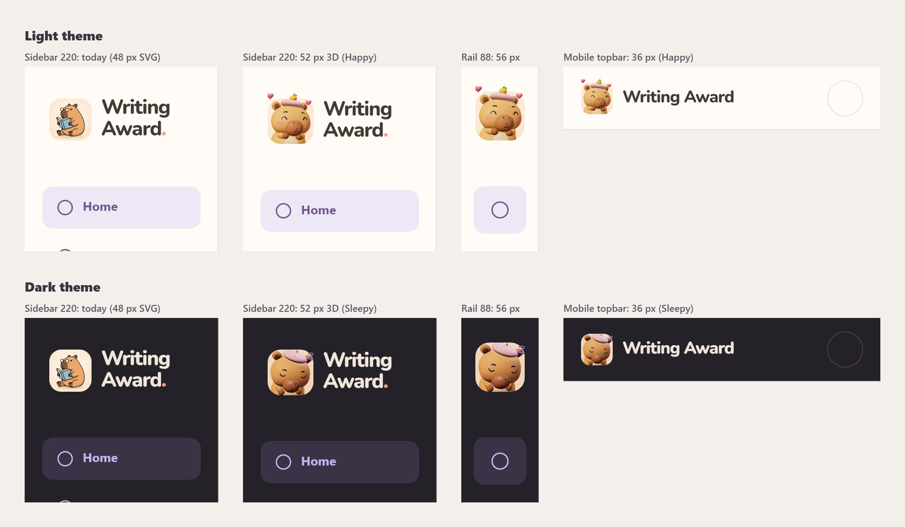
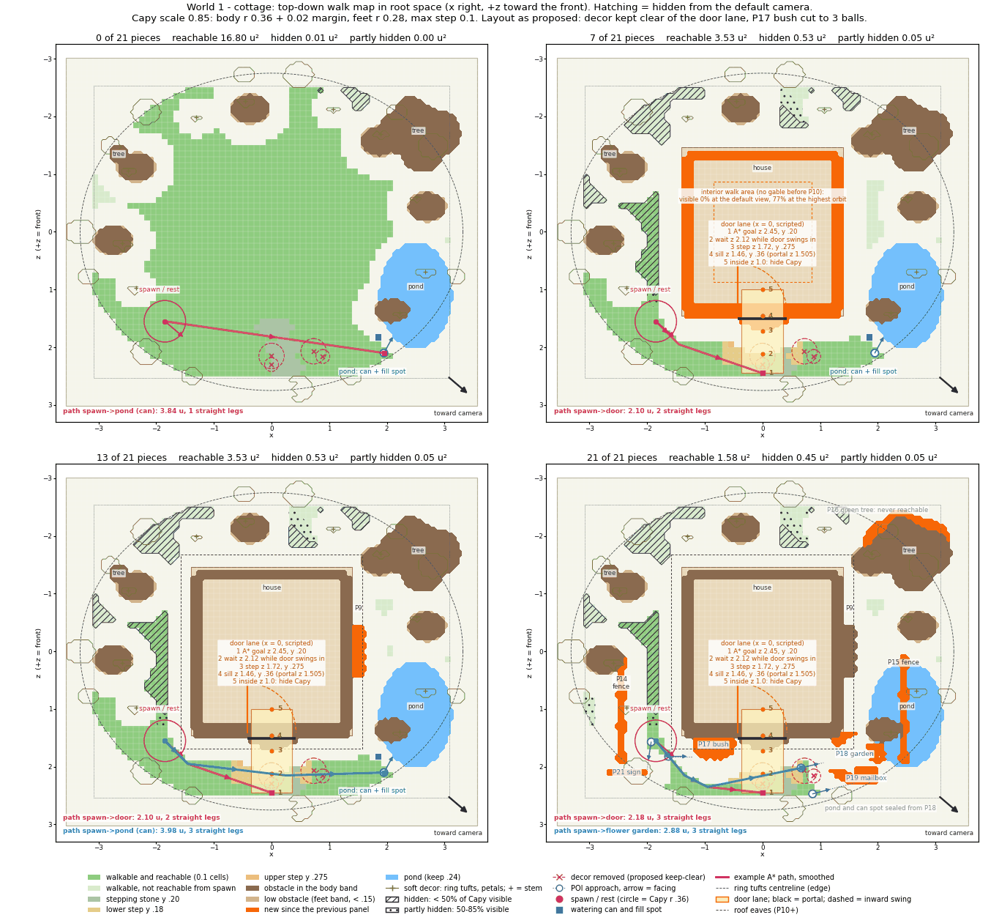
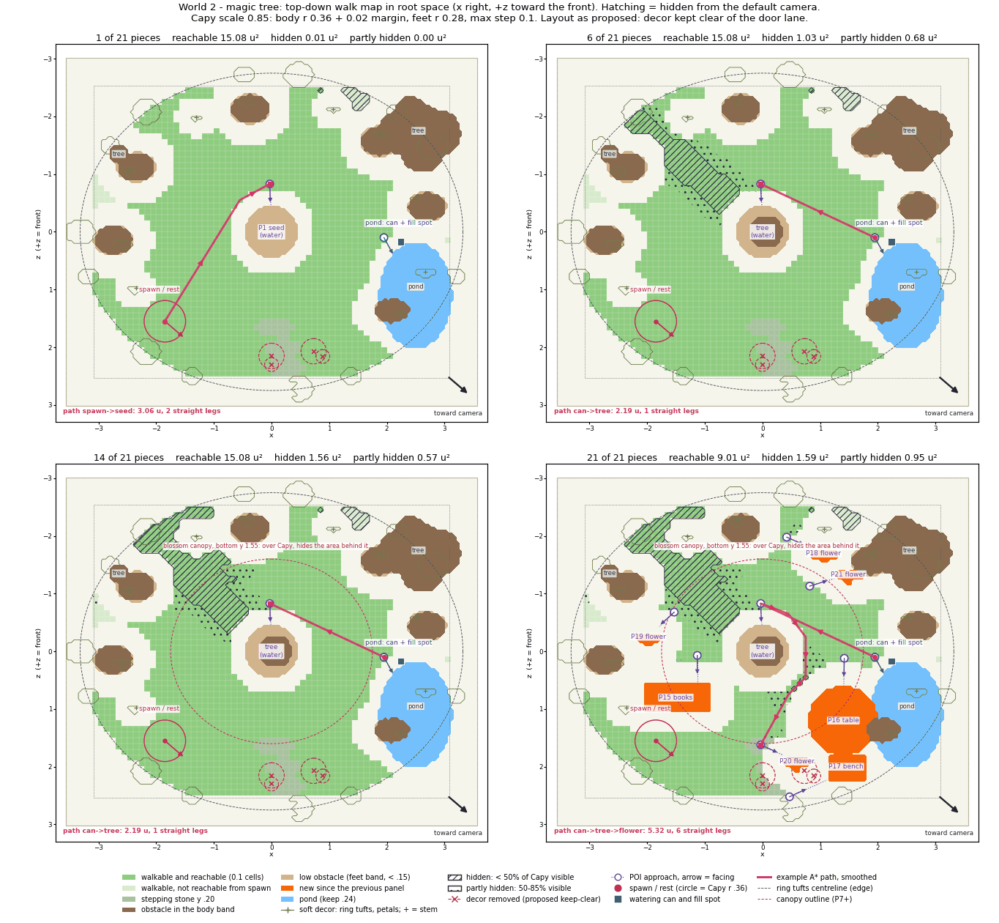
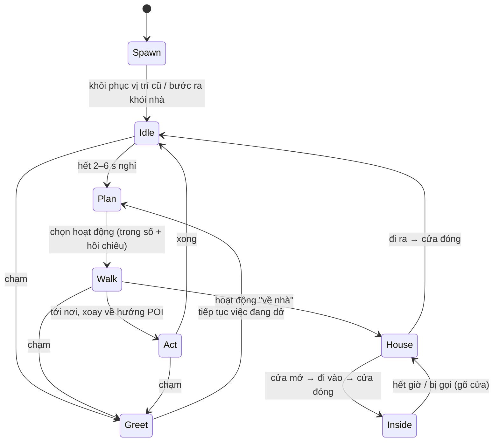
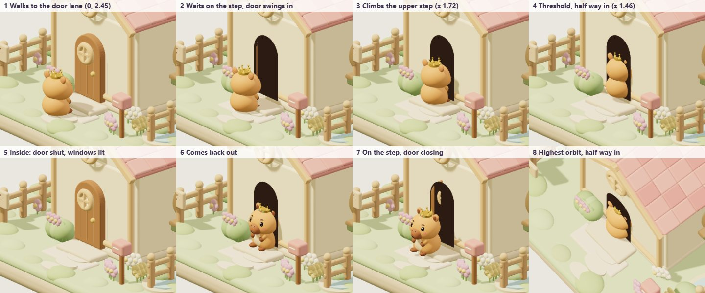
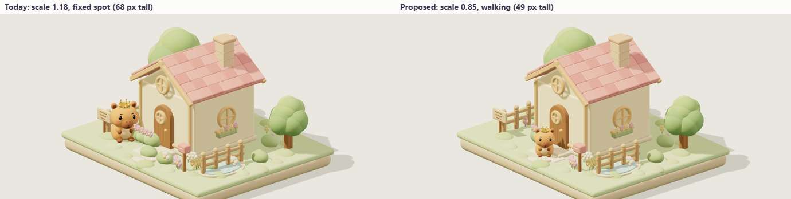
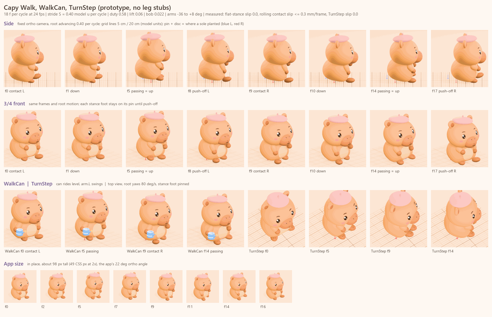
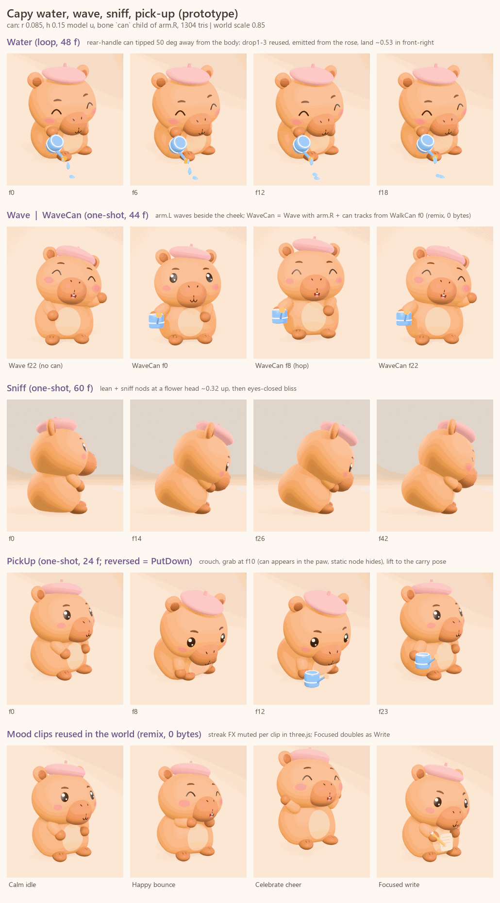

# Capy 3D: logo cảm xúc và Capy sống trong thế giới

> **Đã triển khai** theo các quyết định ở mục 12 (xem mục 13 cho những chỗ khác bản thiết kế). Thiết kế cho hai thay đổi:
> - Logo của web trở thành Capy 3D. Mọi cảm xúc theo chuỗi ngày viết hiện ở đó.
> - Trong thế giới, Capy không đổi cảm xúc nữa mà sống như một nhân vật: đi bộ bằng bước chân thật quanh sân, ra vào nhà khi đã có nhà, tưới cây ở thế giới Magic Tree.
>
> Tài liệu tổng hợp ba mảng phân tích chạy song song (logo, bản đồ/đường đi, animation/đạo cụ) cùng phần hành vi và kiến trúc. Các con số đều đo trên hình học thật của `Scene.tsx`, model `capy.glb` và rig trong `art/capy`. Các ảnh trong [`design/`](design/) là ảnh dựng thật, không phải phác hoạ.

## 0. Tóm tắt

| Hạng mục | Đề xuất |
|---|---|
| Logo | Capy 3D khung đầu-vai trong ô màu đào. Beret và ký hiệu cảm xúc nhô lên trên ô. Hiện 12 cảm xúc theo chuỗi ngày, mỗi lần đổi diễn một đợt ≤ 5 s rồi đứng yên. Bấm thì về trang chủ và Capy giật mình |
| Thế giới | Không đổi cảm xúc theo chuỗi ngày. Capy đi dạo, ghé hoa, hòm thư, kệ sách. Ra vào nhà từ mảnh 7. Tưới cây ở thế giới 2 từ mảnh 1. Ở thế giới 1, tưới bụi hoa và vườn hoa từ mảnh 17 |
| Bước đi | Bước thật: chân đang chống không trượt (đo được 0.0), có gót chạm → mũi đẩy. Thân nhún, tay đánh chéo. Có quy tắc bắt đầu, dừng và xoay tại chỗ |
| Collection | Mỗi thế giới có một tư thế đặc trưng tĩnh, không đổi cảm xúc |
| Kích thước Capy trong thế giới | Scale 1.18 → 0.85 để lọt cửa. Cao khoảng 49 px thay vì 68 px ở zoom mặc định |
| Vào nhà | Cửa mở vào trong, cộng một "khe cửa tối" che phần Capy đã đi qua. Không cần sửa tường hay viết shader |
| Clip mới | `Walk`, `WalkCan`, `TurnStep`, `Water`, `Sniff`, `Wave`, `PickUp`. Ba clip ghép lại từ clip có sẵn, không tốn byte: `WaveCan`, `Cheer`, `Bounce` |
| Đạo cụ | Bình tưới gắn xương `can` trên tay phải, cộng một bình tĩnh đặt trong cảnh |
| Sửa bố cục nhỏ | Dọn 4 món trang trí khỏi lối lên cửa. Bụi hoa mảnh 17 từ 5 còn 3 bụi. Vương miện (mảnh 20) rơi ở `(−1.90, 1.70)` |
| Dung lượng | Kèm toàn bộ clip mới vẫn còn **807 KB** (hiện tại 945 KB) nhờ `gltf-transform dedup + meshopt` (đã đo) |
| Tải máy | Logo khoảng 0.2 ms mỗi khung khi đang diễn, 0 khi đứng yên. Thế giới không tốn thêm GPU |
| Lộ trình | 6 phase, phase nào cũng ship riêng được (mục 10) |

## 1. Hiện trạng và vấn đề

| Chỗ có Capy | Hiện tại | Vấn đề |
|---|---|---|
| Logo (sidebar, topbar mobile) | Ảnh SVG 2D tĩnh (`public/favicon.svg`) | Không sống động, lệch phong cách với Capy 3D |
| Thế giới ở trang chủ | Capy 3D đứng yên ở góc trước-trái `(−1.72, 1.8)`, scale 1.18. Đổi 12 cảm xúc theo chuỗi ngày, giờ, lúc gõ và khi chạm | Chỉ thấy cảm xúc khi đang ở trang chủ: phản ứng một lần như Sad→Grumpy hay Chilly bị lỡ nếu mở app ở trang khác. Capy đứng một chỗ |
| Collection (3 thẻ thế giới) | Capy Calm tĩnh trong thẻ thế giới 1–2 | — |
| Thế giới 3 (Lego) | Không có Capy, vì cả thế giới đã là một con capybara | Giữ nguyên |

**Ràng buộc kỹ thuật phát hiện khi đọc code**

1. **Scene dựng lại toàn bộ khi `pieces`, `world` hoặc `rainy` đổi** ([Scene.tsx:614](../../src/Scene.tsx#L614)). Capy cần "trí nhớ" vị trí qua các lần dựng lại, nếu không sẽ nhảy về chỗ xuất phát mỗi khi có mảnh mới.
2. **`<Logo />` được mount 2 lần cùng lúc**: ở sidebar và `<Logo compact />` trong topbar mobile. CSS ẩn một cái theo breakpoint. Chỉ instance đang hiện mới được giữ WebGL.
3. **Tường trước của nhà là khối liền, không có lỗ cửa.** Cửa gỗ chỉ là một tấm đặt trước tường ([Scene.tsx:79-85](../../src/Scene.tsx#L79-L85), [Scene.tsx:104-110](../../src/Scene.tsx#L104-L110)).
4. **Material được cache theo màu và dùng chung giữa mọi scene** ([Scene.tsx:30-34](../../src/Scene.tsx#L30-L34)). Muốn cửa sổ sáng đèn thì phải clone material riêng, nếu không cả 3 thẻ Collection cũng sáng theo.
5. **Lối lên cửa đang bị chắn.**
   - Bụi trang trí #0 ở `(0, 2.15)` và hoa #0 ở `(0, 2.30)` nằm ngay trên lối đi.
   - Bụi hoa mảnh 17 lấn tới `x = −0.09` ([Scene.tsx:122](../../src/Scene.tsx#L122), [Scene.tsx:343-350](../../src/Scene.tsx#L343-L350)).
6. **Cửa rộng 0.8, cao 1.4, còn Capy ở scale 1.18 rộng 0.94**, nên không lọt cửa.
7. **Vương miện (mảnh 20) đang rơi cắt qua góc mái hiên**, vì mép mái chỉ cách đầu Capy 0.17. Lỗi này có sẵn từ trước.

## 2. Nguyên tắc thiết kế

1. **Cảm xúc ở logo, hành động ở thế giới.**
   - Logo là "chân dung cảm xúc" luôn hiện ở mọi trang, giống avatar trên HUD của game. Mọi phản ứng của chuỗi ngày đều được thấy dù đang ở trang nào: Celebrate khi có mảnh mới, Chilly khi freeze cứu chuỗi, Sad→Grumpy khi đứt chuỗi.
   - Capy trong thế giới là nhân vật sống. Nét mặt theo việc đang làm (đi, tưới, ngửi hoa, vẫy), không theo chuỗi ngày.
2. **Không bao giờ trách** (giữ nguyên nguyên tắc ở [README mục 2](README.md)).
   - Capy trong thế giới không buồn vì đứt chuỗi.
   - Mưa vẫn là tín hiệu duy nhất. Khi mưa, Capy vào nhà hoặc đứng trú dưới tán cây, và thế giới 2 bỏ việc tưới vì "mưa tưới hộ rồi".
3. **Mảnh mới = hành vi mới.**
   - Mỗi mảnh mở khoá một hoạt động: có cửa thì ra vào nhà, có hòm thư thì xem thư, có hoa thì ngửi hoa, có cây thì tưới cây.
   - Phần thưởng hằng ngày vì thế không chỉ là đồ trang trí tĩnh mà làm thế giới "sống" thêm.
4. **Chuyển động thật nhưng êm.**
   - Bước chân thật, không trượt. Đi chậm, có nghỉ, không giật.
   - Tôn trọng `prefers-reduced-motion`, khi đó Capy đứng yên ở tư thế đặc trưng.
5. **Rẻ.** Dùng chung một model và một rig. Vòng vẽ của thế giới vốn đã chạy liên tục, nên Capy đi lại gần như không tốn thêm GPU.

## 3. Logo 3D: chân dung cảm xúc



Toàn bộ 12 cảm xúc ở mọi kích thước, DPR 1 và 2, mỗi ô có ảnh kích thước thật và ảnh phóng to 3×: [design/logo-moods.webp](design/logo-moods.webp). Các phương án đã thử (khung hình, ánh sáng, vương miện, khử răng cưa, favicon động): [design/logo-studies.webp](design/logo-studies.webp).

### 3.1 Kích thước và khung hình

| Vị trí | Ô logo | Canvas (CSS px) |
|---|---|---|
| Sidebar desktop (220 px, 190 px) | 52 px (hiện tại 48). Vẫn vừa sidebar 190 px: 52 + 11 + 78 = 141/146 px | 52 × 75 |
| Sidebar thu gọn 88 px (761–1050 px) | 56 px | 56 × 81 |
| Topbar mobile (≤ 760 px) | 36 px | 36 × 52 |

- **Khung đầu-vai (bust).**
  - Toàn thân thì mặt quá nhỏ. Cận đầu thì mất beret và tay.
  - Camera `PerspectiveCamera` fov 24°. Với Calm: vị trí `(0.03, 1.152, 3.205)`, nhìn vào `(0.03, 0.903, 0.094)`.
  - Capy xoay `0.18 rad`, hướng về phía chữ "Writing Award". Thông số giống nhau ở mọi breakpoint.
- **Camera bám đầu theo từng cảm xúc.** Camera dịch theo 0.7 × độ lệch đầu so với Calm. Sleepy và Sad cúi đầu mà không mất miệng, Celebrate nhảy mà không mất đầu. Mặt to hơn khoảng 25% so với một khung cố định chứa vừa mọi cảm xúc.
- **Canvas cao hơn ô 45%.**
  - Đáy canvas cắt theo bo góc ô, đỉnh để mở. Beret, mây mưa, dấu "!" và lấp lánh nhô lên trên ô như nhãn dán.
  - Không tràn ngang vì sẽ đè lên chữ.
- **Hiệu ứng nổi to thêm.** Trong logo, các ký hiệu nổi được phóng 1.25× và kéo vào 15% về phía đầu. Đây là một tuỳ chọn mới của `createCapy`.

### 3.2 Ánh sáng

- **Rig đèn riêng, gắn theo camera, không đổ bóng.**
  - Sáng: key `#fff1d8` 3.1, fill `#e6e0ff` 0.35, rim nhẹ 0.8. Rim mạnh làm bạc màu nền ô kem.
  - Tối: giữ nền ô màu đào nhưng dịu hơn (`#f8ead9 → #efd3b4`), thêm rim lạnh `#cdbff7`. Nền ô tối màu chiều tà thì chìm vào sidebar tối.

### 3.3 Chuyển động: chạy từng đợt rồi nghỉ

- **Khi cảm xúc đổi:** cross-fade sang clip mới và chạy tối đa 5 s (Celebrate 2 vòng, cảm xúc khác 1 vòng). Sau đó dừng êm (`halt(0.6)`) đúng ở khung đẹp nhất (HERO) và **ngừng vẽ**.
- **Lý do không lặp liên tục:**
  - WCAG 2.2.2 yêu cầu nội dung tự chuyển động quá 5 s phải có nút dừng.
  - Một logo cứ nhúc nhích sẽ làm phân tâm khi đang viết bài.
- **Hover hoặc focus bàn phím** vào logo thì chạy lại một vòng.
- **Kết xuất:**
  - 30 fps trong lúc chạy, 0 fps lúc nghỉ.
  - Dừng khi tab bị ẩn hoặc logo ra khỏi màn hình. Trên mobile, topbar cuộn mất.
  - Pixel ratio `clamp(DPR, 2, 3)`. Render 2× trên màn DPR 1 làm mắt và lông mày sắc hơn hẳn.
- **Reduced motion:** dùng đường `still` có sẵn (tư thế HERO).

### 3.4 Kiến trúc logo

- **Một renderer duy nhất.**
  - Một singleton ở `src/CapyLogo.tsx` giữ renderer, canvas và Capy.
  - Mỗi `<Logo>` đăng ký phần tử `.brand-mark` của mình. Một `ResizeObserver` đưa canvas cho phần tử nào đang có kích thước khác 0 (`display:none` báo 0×0).
  - Cách này bám theo breakpoint CSS mà không lặp lại logic trong JS. Canvas được chuyển chỗ vẫn giữ nguyên WebGL context.
- **Kênh phản ứng `capyBus.react(mood)`** thay vì ref, vì có 2 instance.
  - Chỉ singleton lắng nghe. Nó gọi `actor.react()`, không đụng hàng đợi mood.
  - Hàm dùng chung `nextPokeReaction()` (4 lần trong 3 s → Grumpy) đếm chung lượt chạm Capy trong thế giới và lượt bấm logo.
- **`markReady`** chạy ở khung hình đầu tiên logo vẽ được. Nếu chắc chắn phải dùng fallback thì cũng gọi một lần, để hàng đợi mood không bị treo. Bỏ `onCapyReady` khỏi Scene.

```tsx
function Logo({ compact = false, mood, onReady }: { compact?: boolean; mood: CapyMood; onReady?: () => void }) {
  return <a className="brand" href="#home" aria-label="Writing Award, back to your corner" onClick={() => capyBus.react(nextPokeReaction())}>
    <CapyMark mood={mood} onReady={onReady} /> {/* span.brand-mark > img[src=/favicon.svg]; capyLogo.attach(el) */}
    {!compact && <span>Writing<span>Award<span className="brand-dot">.</span></span></span>}
  </a>;
}
// App: <Logo mood={capyMood} onReady={capyReady} /> ×2; <Scene … onCapyPet={capyBus.react} />
```

CSS (thay quy tắc kích thước `.mobile-brand img` hiện có):

```css
.brand-mark{--mark-r:15px;--mark-pop:23px;position:relative;flex:none;width:52px;height:52px;border-radius:var(--mark-r);background:radial-gradient(58% 58% at 50% 42%,#fff9f0,#fbe6ce)}
.brand-mark img{display:block;width:100%;height:100%;transition:opacity .2s}
.brand-mark canvas{position:absolute;inset:auto 0 0;height:calc(100% + var(--mark-pop));border-radius:0 0 var(--mark-r) var(--mark-r);pointer-events:none;opacity:0;transition:opacity .2s}
.brand-mark.is-live img{opacity:0}.brand-mark.is-live canvas{opacity:1}
:root[data-theme=dark] .brand-mark{background:radial-gradient(58% 58% at 50% 42%,#f8ead9,#efd3b4);box-shadow:inset 0 0 0 1px #ffffff1a}
/* 761–1050px */ .sidebar .brand-mark{--mark-r:16px;--mark-pop:25px;width:56px;height:56px}
/* ≤760px */ .mobile-brand .brand-mark{--mark-r:10px;--mark-pop:16px;width:36px;height:36px}
```

### 3.5 Fallback, accessibility, tương tác

- **Fallback:**
  - Giữ `favicon.svg` cho tới khung hình 3D đầu tiên rồi cross-fade sang.
  - Giữ hẳn SVG khi không tạo được WebGL, khi WebAssembly bị chặn (ví dụ iOS Lockdown Mode), hoặc khi bật Save-Data mà model chưa có trong cache.
  - Hiện lại SVG khi mất WebGL context.
- **Accessibility:** vẫn là một link với nhãn như cũ, không đưa cảm xúc vào tên đọc của link. Canvas có `aria-hidden`.
- **Bấm logo:** vẫn về trang chủ, đồng thời Capy giật mình (Surprised). Bấm từ 4 lần trong 3 s thì Grumpy.
- **Không đội vương miện trong logo.**
  - Beret là hình dáng nhận diện. Ở 36 px vương miện chỉ là một vệt vàng.
  - Đội vương miện thường trực thì Proud không còn khác biệt.
  - Capy trong thế giới vẫn đội vương miện như hiện nay.
- **Không làm favicon động.** Ở 16 px không cảm xúc nào đọc được.

## 4. Bản đồ và đường đi

Phân tích dựng lại toàn bộ hình học từ `Scene.tsx` (voxel 5 cm, lưới đi 0.1). Độ nhìn thấy được kiểm tra bằng 9 tia từ các điểm trên thân Capy tới camera mặc định. Toạ độ ở không gian `root`; hướng mặt là `rotation.y = atan2(dx, dz)`. Dữ liệu đầy đủ (vật cản, POI, thống kê, đường mẫu) có trong [design/capy-nav-data.json](design/capy-nav-data.json).





### 4.1 Vùng đi được, độ cao, độ nhìn thấy

- **Biên:** tâm Capy luôn nằm trong elip của vòng bụi viền (3.32 × 2.75), đồng thời `|x| ≤ 3.085`, `|z| ≤ 2.535`.
- **Độ cao mặt đất:**

  | Mặt | Cỏ | Đá lát | Bậc dưới | Bậc trên | Ngưỡng cửa |
  |---|---|---|---|---|---|
  | `y` | .13 | .20 | .18 | .275 | .36 |

  Mỗi ô lưới chỉ cho bước cao thêm tối đa 0.10. Bậc cao nhất thực tế là 0.095.
- **Diện tích đi được (u²):**

  | Thế giới | Số mảnh | Đi được | Khuất camera |
  |---|---|---|---|
  | 1 | 0 | 16.8 | 0.01 |
  | 1 | 7 và 13 | 3.53 | 0.53 |
  | 1 | 21 | 1.58 | 0.45 |
  | 2 | 1–14 | 15.08 | 0.01 → 1.56 |
  | 2 | 21 | 9.01 | 1.59 |

  - Thế giới 1: vùng khuất là dải bên trái nhà và phía sau nhà.
  - Thế giới 2: vùng khuất là phần sau thân cây, rộng dần khi có tán.
  - Capy có thể đi ngang qua vùng khuất nhưng không chọn làm chỗ đứng chơi.
- **Kích thước trên màn hình ở scale 0.85:** khoảng 49 px ở zoom 1, từ 37 px (zoom 0.75) đến 79 px (zoom 1.6). Trên điện thoại khoảng 36–38 px. Hôm nay là 68 px.
- **Vừa cửa:**
  - Ở 0.85, Capy còn dư 0.06 mỗi bên, và đỉnh đầu (1.343) thấp hơn chỗ vòm cửa bắt đầu cong (1.36).
  - Ở 0.90 vẫn lọt, nhưng chỉ dư 0.04 mỗi bên. Từ 0.95 trở lên thì không lọt.

### 4.2 Điểm đến (POI)

Mọi điểm đứng đều nhìn thấy trọn vẹn từ camera mặc định và còn hợp lệ từ mảnh mở khoá trở đi.

| Thế giới | Điểm đến | Chỗ đứng (x, z) | Hướng `rot.y` | Mảnh |
|---|---|---|---|---|
| cả hai | Chỗ xuất hiện / nghỉ | (−1.85, 1.55) | 0.864 (nhìn camera) | luôn |
| 1 | Đứng chơi trước bậc thềm | (0, 2.15) | 0.864 | 2–21 |
| 1 | Cửa: đích của A*, sau đó đi theo kịch bản cố định | (0, 2.45) | π | 7–21 |
| 1 | Bụi hoa (mảnh 17) | (−1.63, 1.82) | 1.571 | 17–21 |
| 1 | Vườn hoa (mảnh 18) | (0.67, 2.02) | 1.809 | 18–21 |
| 1 | Hòm thư (mảnh 19) | (0.87, 2.47) | 1.832 | 19–21 |
| 1 | Biển chào (mảnh 21) | (−1.93, 1.57) | −0.157 | 21 |
| 1 | Bờ ao | (1.95, 2.10) | 2.639 | **chỉ 0–17**. Từ mảnh 18 vườn hoa và hòm thư chắn lối |
| 1 | Cây xanh (mảnh 16) | không tới được, vì nhà chắn phía phải ngay từ mảnh 1 | – | – |
| 2 | Gốc cây phép (tưới) | (−0.03, −0.83), đứng sau thân, mặt hướng về camera | 0.03 | 1–21 |
| 2 | Kệ sách (mảnh 15) | (−1.13, 0.07) | 0 | 15–21 |
| 2 | Bàn tròn (mảnh 16) | (1.42, 0.12) | −0.023 | 16–21 |
| 2 | Ghế đôn (mảnh 17) | (0.47, 2.52) | 2.003 | 17–21 |
| 2 | Hoa lớn (mảnh 18 / 19 / 20 / 21) | (0.42, −1.98) / (−1.53, −0.68) / (−0.03, 1.62) / (0.82, −1.13) | 1.157 / −0.831 / 1.139 / 1.875 | mảnh của nó trở đi |
| 2 | Bờ ao và chỗ để bình (bình ở 2.24, 0.17) | (1.95, 0.10) | 0.503 | luôn |

Thêm điểm ngửi **hoa trang trí** ở thế giới 1: sinh tự động, đứng cách thân hoa 0.5, lọc theo hai điều kiện là tới được và nhìn thấy được. Nhờ vậy trước mảnh 17 vẫn có hoa để ngửi.

### 4.3 Tìm đường: lưới A*

| Thành phần | Thông số |
|---|---|
| Lưới | Ô 0.1 (72 × 60), kiểm tra tại tâm ô |
| Khoảng hở | 0.38 với vật cao ≥ 0.15 so với mặt đất (thân). 0.28 với vật thấp (bàn chân). 0.24 với mép ao. 0.36 với thân hoa trang trí |
| Bậc | Chênh lệch ≤ 0.10 giữa hai ô |
| Tìm kiếm | 8 hướng, không cắt góc. Cộng thêm chút chi phí gần bụi viền và cánh hoa |
| Làm mượt | Line-of-sight, còn 1–6 đoạn thẳng |
| Vật cản | Lưu dạng dữ liệu: hình, cộng mảnh làm nó xuất hiện. Vật cản chỉ tăng chứ không giảm, nên mỗi số mảnh có một mask |
| Khi mảnh mới bắt đầu rơi (850 ms) | Dựng lại mask. Nếu ô hoặc đường của Capy bị chặn thì đi ra ô trống gần nhất trước |
| Không dùng đồ thị waypoint | Khoảng 10 nút là đủ cho thế giới 1, nhưng quá thô cho 9–15 u² đất trống của thế giới 2 |

### 4.4 Thay đổi bố cục cần thiết

Cả hai bản đồ trên đều đã giả định các thay đổi này. Nếu không làm, Capy không tới được cửa, và thế giới 1 ở 21 mảnh chỉ còn 0.61 u² đi được thay vì 1.58.

1. **Giữ lối cửa trống:** không đặt bụi và hoa trang trí trong vùng `|x| < 1.0, z > 1.3`. Thực tế chỉ bỏ 4 món: bụi #0 `(0, 2.15)`, bụi #8 `(0.73, 2.07)`, hoa #0 `(0, 2.30)`, hoa #8 `(0.89, 2.16)`. Thêm một điều kiện vào vòng lặp trang trí, giống điều kiện đang chừa chỗ cho Capy.
2. **Bụi hoa mảnh 17 còn 3 bụi** ở `x = −0.97 / −0.845 / −0.72`, mép phải ở `−0.47`. Bản 5 bụi lấn tới `−0.09`, chồng lên lối cửa.
3. **Vương miện (mảnh 20) rơi ở `(−1.90, 1.70)`**, độ cao nghỉ `0.13 + 1.157 × 0.85 = 1.11`. Ở đó phía trên đầu trống 0.30, và quanh thân dư 0.077. Chỗ cũ `(−1.72, 1.80)` làm vương miện cắt qua góc mái hiên.

## 5. Hành vi của Capy trong thế giới

### 5.1 Máy trạng thái



- **Hoạt động** là một danh sách bước thuần dữ liệu: `walk`, `face`, `clip`, `door`, `inside`, `hold` (cầm/bỏ bình), `fx` (giọt nước, lấp lánh, khói, đèn), `wait`. Bộ não chỉ thực thi lần lượt các bước, nên dễ test và dễ thêm hoạt động mới.
- **Bộ lập lịch** chọn hoạt động tiếp theo:
  - Bốc thăm có trọng số trong số các hoạt động đã mở khoá.
  - Không lặp lại hoạt động vừa làm, và tôn trọng hồi chiêu của từng hoạt động.
  - Nghỉ 2–6 s giữa các việc: đứng thở (Calm), nhìn quanh.
- **Ngắt** đẩy bước mới lên đầu hàng đợi rồi quay lại việc đang dở. Đang đi thì tính lại đường. Đang cầm bình thì vẫn cầm.

### 5.2 Hoạt động ở thế giới 1: Capy's Dream Cottage

`k` = số mảnh đã xây. Mảnh `k` là `parts[k-1]`.

| Hoạt động | Mở khi | Diễn biến | Trọng số | Hồi chiêu |
|---|---|---|---|---|
| Dạo sân | luôn | Đi tới một điểm ngẫu nhiên trong vùng nhìn thấy, đứng nhìn quanh | 3 | — |
| Ngắm mảnh mới | k ≥ 1 | Đi tới mảnh mới nhất, ngắm và nảy nhẹ (`Bounce`) | 4 trong ngày có mảnh mới, sau đó 1 | 60 s |
| Ngửi hoa | luôn (hoa trang trí). Thêm bụi hoa ở k ≥ 17, vườn hoa ở k ≥ 18 | Đi tới hoa → `Sniff` | 2 | 25 s |
| Ngắm ao | k ≤ 17 | Đứng ở bờ ao, cúi nhìn mặt nước | 1.5 | 40 s |
| Viết nhật ký | luôn. Đứng ở bậc thềm khi k ≥ 2 | Lấy sổ ra viết (clip `Focused` có sẵn, vì app là app viết) | 1.5 | 60 s |
| **Về nhà** | **k ≥ 7 (có cửa)** | Kịch bản ở mục 5.4. Ở trong 8–20 s. Khi Capy ở trong, cửa sổ sáng đèn, ống khói nhả khói (k ≥ 13) | 2 | 50 s |
| Xem hòm thư | k ≥ 19 | Đi tới hòm thư, ngó vào, cờ hòm thư bật lên | 1.5 | 60 s |
| Tưới hoa | k ≥ 17 | Vào nhà lấy bình → ra tưới bụi hoa (17) và vườn hoa (18) → mang bình vào cất. Bình cất trong nhà và "múc nước trong nhà", vì từ mảnh 18 không ra được ao | 1.5 | 90 s |
| Vẫy ở biển chào | k = 21 | Đứng cạnh biển "Welcome", vẫy về phía camera | 0.5 | 90 s |

**Biến thể "ra vào nhà linh hoạt"**, để không lặp một kiểu:
- *Ghé nhanh*: vào rồi ra ngay, ở trong 2–4 s.
- *Ở lâu*: 12–20 s, cửa sổ sáng và có khói.
- *Lấy đồ*: vào rồi ra với bình tưới trên tay, nối tiếp việc tưới hoa.
- *Chào buổi sáng*: lần đầu mở app trong phiên, nếu đã có cửa thì Capy bước từ trong nhà ra và vẫy.
- *Gõ cửa*: khi Capy đang ở trong, chạm vào nhà thì cửa mở, Capy ló ra vẫy.

Khi xây đủ 21 mảnh, sân trước chỉ còn một dải sâu khoảng 0.6. Lúc đó Capy sẽ chủ yếu sống quanh bậc thềm, vườn hoa, hòm thư và trong nhà. Đây là điều tự nhiên với một ngôi nhà đã hoàn thiện.

### 5.3 Hoạt động ở thế giới 2: Magic Tree

| Hoạt động | Mở khi | Diễn biến | Trọng số | Hồi chiêu |
|---|---|---|---|---|
| **Tưới cây phép** | **k ≥ 1** (ụ đất, xem như hạt giống) | Tới chỗ để bình ở ao → `PickUp` → múc nước → `WalkCan` tới gốc cây → `Water` 2–3 nhịp → cây lấp lánh, tán nảy nhẹ (k ≥ 7) → tưới thêm 1 bông hoa lớn nếu k ≥ 18 → mang bình về → `PutDown` | 4 | 45 s |
| Đọc sách | k ≥ 15 (kệ sách) | Đứng cạnh kệ, mở sổ đọc | 2 | 60 s |
| Viết bên bàn | k ≥ 16 (bàn tròn), k ≥ 17 (ghế đôn) | Đứng bên bàn hoặc ghế, viết sổ | 1.5 | 60 s |
| Ngắm hoa lớn | k ≥ 18 | Hoa lớn cao 0.37, quá tầm của `Sniff` (0.27), nên ngắm và nảy nhẹ (`Bounce`) | 1.5 | 30 s |
| Ngắm ao, dạo, ngắm mảnh mới | như thế giới 1 | | | |

Ở thế giới này cây là trung tâm, nên tưới cây có trọng số cao nhất. Ngay từ mảnh đầu tiên (ụ đất), Capy đã tưới "hạt giống". Cây lớn dần theo số mảnh, còn hành động chăm cây giữ nguyên, tạo cảm giác "mình đang nuôi cây này".

Chỗ đứng khi tưới cần lùi theo vector rót nước (vòi đổ xuống cách khoảng 0.65 về phía trước bên phải), để nước rơi đúng gốc cây hay bông hoa.

### 5.4 Đi vào và ra khỏi nhà



Ảnh dựng bằng đúng hình học `buildCottage` và trang trí (đã áp dụng các thay đổi ở mục 4.4), đúng camera và đèn, với `capy.glb` ở scale 0.85.

**Cách làm**

1. **Cửa có bản lề, mở vào trong.**
   - Bọc tấm cửa trong group "bản lề" ở mép sau-trái `(−0.425, 1.405)`.
   - Khi mở, `rotation.y` đi từ 0 đến +92° trong 0.45 s (ease-out). Khi đóng, 0.35 s và nảy nhẹ một cái.
   - Ở 10 / 20 / 30 / 45°, phần cửa còn thấy được lần lượt là 63 / 20 / 11 / 3%. Tấm cửa "chìm" vào bóng tối như cửa thật mở vào nhà.
   - Các phương án khác đều kém hơn. Mở ra ngoài với bản lề phải thì che 89% khe cửa. Mở ra ngoài với bản lề trái thì đập vào bụi hoa.
2. **Khe cửa tối.**
   - Một mặt phẳng hình vòm đúng hình cửa, màu `#3b2b22` (`MeshBasicMaterial`).
   - Đặt ở `z = 1.505`, trước gờ chân tường (gờ cắt ngang lối cửa ở z 1.38–1.50). Khi cửa đóng, mặt phẳng nằm gọn trong tấm cửa. Chỉ hiện khi cửa mở quá 4°.
   - Phần thân Capy đã đi qua mặt phẳng bị chính nó che theo depth test thông thường. Phần còn ở ngoài vẫn hiện. Nhìn giống Capy bước vào bóng tối trong nhà.
   - Không cần shader, stencil hay cắt mesh. Đúng ở mọi góc xoay camera (ảnh 8 là góc nhìn cao nhất).
3. **Lối đi theo kịch bản:**
   - A* tới `(0, 2.45)`, đứng trên đá lát (y .20), quay mặt về cửa.
   - Chờ ở `(0, 2.12)` trong 0.45 s cửa mở.
   - Bước lên bậc trên `(0, 1.72)`, y .275.
   - Qua ngưỡng `(0, 1.46)`, y .36.
   - Vào trong `(0, 1.0)`.
   - Phần Capy còn thấy được: 92 / 59 / 41 / 24% ở z 1.75 / 1.6 / 1.45 / 1.3, và 0% từ z 1.15.
4. **Khi đã vào trong:**
   - Mảnh 7–9 (chưa có đầu hồi): người dùng xoay camera lên cao sẽ thấy 77% lòng nhà. Vì vậy Capy đi tới một điểm bên trong (vùng `x ±0.85, z ±0.87`, nền y .36) và đứng viết sổ.
   - Từ mảnh 10 trở đi, đầu hồi đóng kín lòng nhà ở mọi góc nhìn. Khi đó ẩn Capy, ẩn cả hitbox, và dừng mixer.
   - Cần ẩn hitbox vì `isHittingCapy` chỉ kiểm tra `visible` của chính mesh trúng tia. Nếu chỉ ẩn group thì vẫn chạm được Capy xuyên qua tường.
5. **Khi ra:** làm ngược lại. Mặt Capy hiện dần khỏi bóng tối (ảnh 6), bước xuống bậc, cửa tự đóng sau lưng (ảnh 7).
6. **Cửa sổ sáng đèn:** clone material kính cho ô cửa sổ tròn (mảnh 8), cửa sổ hông (mảnh 9) và ô kính trên cửa. Bật emissive `#ffc46a` (ảnh 5).



Capy nhỏ hơn nhưng vẫn đọc rõ, và tỉ lệ với ngôi nhà hợp lý hơn: cửa cao khoảng 1.4 lần Capy.

### 5.5 Ngắt: chạm, mảnh mới, mưa

- **Chạm vào Capy trong thế giới:**
  - Capy dừng lại, quay về phía camera bằng `TurnStep`, `Wave` và thả tim (tim giữ như hiện nay), rồi làm tiếp việc dở.
  - Nếu đang cầm bình thì dùng `WaveCan`: tay trái vẫy, tay phải vẫn giữ bình.
  - Logo phản ứng thay cho thế giới: Surprised, hoặc Grumpy kèm toast hiện có "Capy puffs up its cheeks…".
  - Hitbox nên to hơn thân khoảng 1.3× cho dễ chạm trên điện thoại, vì Capy chỉ còn 36–38 px.
- **Mảnh mới rơi xuống** (sau khi đóng hộp thoại phần thưởng):
  - Logo chạy Celebrate (và Proud) như hiện nay.
  - Trong thế giới, Capy quay về phía mảnh mới và cổ vũ (`Cheer`), rồi đi tới ngắm.
  - **Mảnh 20 (vương miện):** khi scene dựng lại cho lần rơi này, đặt Capy ở `(−1.90, 1.70)`, quay mặt về camera. Vương miện rơi xuống đầu ở độ cao 1.11. Đáp xong thì Capy nảy lên và từ đó đội vương miện.
- **Mưa** (`rainy`):
  - Thế giới 1 đã có mái: Capy ở trong nhà phần lớn thời gian, cửa sổ sáng đèn.
  - Thế giới 1 chưa có mái: Capy đứng trú dưới gốc cây trang trí.
  - Thế giới 2: Capy đứng dưới tán cây phép (k ≥ 7) và bỏ việc tưới.
- **Ban đêm (tuỳ chọn), 22:00–05:59:** Capy ở trong nhà nhiều hơn, cửa sổ sáng. Đây là không khí, không phải cảm xúc. Logo lúc đó đã hiện Sleepy.

### 5.6 Di chuyển: bước đi thật, không trượt

**Yêu cầu:** khi đi, chân phải bước thật và tay phải đánh như người thật đi bộ. Chi tiết tư thế và số đo ở mục 6.1. Phần code phải giữ đúng các quy tắc sau để bước chân trên màn hình không trượt:

| Quy tắc | Giá trị |
|---|---|
| Đồng bộ bước | `timeScale = tốc_độ / (0.40 × 0.85 / 0.75) = tốc_độ / 0.453`. Đi 0.5 u/s thì timeScale 1.10. Cầm bình đi 0.4 u/s thì 0.88 |
| Bắt đầu đi | Từ `Calm`, fade 0.2 s vào `Walk` tại một khung "lướt qua" (5.2 hoặc 14.2 trên 18). Tăng timeScale và tốc độ thân cùng nhau từ 0 trong 0.25 s |
| Dừng | Khi clip còn cách khung "lướt qua" 2.4 khung, giảm đều timeScale và tốc độ về 0 trong 0.2 s, để dừng đúng lúc hai chân gần nhau. Sau đó fade 0.2 s về `Calm` |
| Rẽ | Ở góc đường dùng `TurnStep`: xoay tại chỗ 80°/s, chân bước theo, chân đang chống xoay ngược đúng bằng góc xoay của thân. Rẽ phải thì chạy clip ngược (timeScale âm). Khi đang đi chỉ được chỉnh hướng ≤ 15°/s, nếu nhanh hơn chân sẽ trượt |
| Độ cao | `y` bám hàm độ cao mặt đất (mục 4.1) có làm mượt. Lên bậc thì nhún nhẹ |
| Chống kẹt | Đi 2 s mà chưa được 0.05 thì tính lại đường hoặc đổi hoạt động |
| Chọn điểm dạo | Chỉ chọn ô nhìn thấy được từ camera mặc định (mục 4.1) |

### 5.7 Trí nhớ qua các lần dựng lại scene

- Một `Map<world, {x, z, heading, holding, activity}>` ở cấp module, cập nhật mỗi khung hình (rất rẻ).
- Khi scene dựng lại vì có mảnh mới hoặc trời mưa: đặt Capy về đúng chỗ cũ. Nếu chỗ đó vừa bị mảnh mới chiếm, ví dụ hàng rào, thì dời ra ô trống gần nhất.
- Lần đầu mở app trong phiên: nếu có cửa thì Capy bước từ trong nhà ra. Nếu không thì "pop in" ở chỗ nghỉ `(−1.85, 1.55)`.

### 5.8 Reduced motion và Collection

- **Reduced motion:** Capy không đi lại mà đứng ở một **tư thế đặc trưng tĩnh**.
  - Thế giới 1: đứng trước bậc thềm `(0, 2.15)`, Calm. Nếu chưa có bậc thì đứng ở chỗ nghỉ.
  - Thế giới 2: cầm bình đứng cạnh gốc cây, dùng khung hero của clip `Water`.
  - Chạm thì chuyển sang tư thế vẫy trong 1.5 s.
- **Collection (thẻ nhỏ):** dùng đúng tư thế đặc trưng tĩnh đó, không vòng lặp, không đổi cảm xúc. Mỗi thẻ kể một câu chuyện nhỏ: Capy trước cửa nhà, Capy tưới cây.
- **Hộp thoại phần thưởng:** vẫn không có Capy.

## 6. Animation và đạo cụ mới

### 6.1 Đi bộ thật



| Thông số | Giá trị đo trên mesh đã skin, có cộng chuyển động gốc |
|---|---|
| Chu kỳ | 18 khung = 0.75 s ở 24 fps. Clip dài 36 khung (2 chu kỳ) để chớp mắt không lặp đều |
| Sải chân | S = 0.40 đơn vị model mỗi chu kỳ, tức 0.453 u/s ở timeScale 1 và scale 0.85 |
| Dáng đi | Thời gian chạm đất 58% chu kỳ, nhấc chân 0.06, thân nhún 0.022 (đỉnh đầu dịch 0.033) |
| Tay | Đánh chéo với chân, từ −36° (trước) đến +8° (sau) |
| **Trượt chân** | **0.0 khi bàn chân phẳng trên đất.** Tối đa 0.28 mm/khung lúc lăn gót → mũi. Đế chân luôn cách mặt đất dưới 0.1 mm. `TurnStep` cũng trượt 0.0 |

**Chu kỳ 4 tư thế khoá cho mỗi chân:**
- Chạm, mũi chân hếch 14° (f0).
- Hạ, thấp nhất (f1).
- Lướt qua, cao nhất (f5).
- Mũi đẩy 26° (f8).
- Chân kia lặp lại ở f9 / f10 / f14 / f17.

**Chân:**
- Lăn trên đế hình bầu dục mà không trượt: gót chạm, phẳng sau 16% thời gian chạm đất, gót nhấc ở 62%, mũi đẩy.
- Chân vung đi theo đường cong mượt. Lúc nhấc lên và lúc đặt xuống, chân lùi về sau cho khớp tốc độ mặt đất.
- Vung ra ngoài 1.2 cm.

**Thân và trọng lượng:**
- Nâng 0.03. Lắc ngang 0.016 và nghiêng 5° về phía chân đang chống.
- Hông xoay ±5° theo chân trước, ngược chiều tay.
- Ngả về trước 5°, nén 2.4% ở điểm thấp nhất.

**Đầu và tai:**
- Đầu xoay bù để mắt nhìn thẳng, nhưng giữ lại 40% độ nghiêng để dáng lạch bạch vẫn đọc được ở cỡ nhỏ.
- Đầu gật trễ một chút. Tai đung đưa trễ nhịp.

**Tay:**
- Đánh ngược chân, chậm lại ở hai đầu, bàn tay trễ nhịp.
- Biên sau dừng ở +8° kèm xoè ra, để bàn tay chỉ lún vào bụng 0.062 (lúc đứng là 0.046).
- Rig không có khuỷu tay, nên cả cánh tay xoay từ vai.

**Không cần thêm chân.** Bàn chân chỉ tách khỏi bụng ở 4/72 khung-chân, và tối đa 2.1 mm. Đã thử thêm một đoạn "chân ngắn" 240 tam giác: không thấy khác biệt gì, nên không thêm.

**Ở cỡ trong app (khoảng 49 px):** độ nhún và độ nén nhỏ hơn 1 px. Dáng đi đọc được qua bàn chân quét 9 px, nhấc 2.5 px, thân nghiêng và tay đánh. Đúng là những thứ mắt nhìn thấy khi người thật đi bộ.

### 6.2 Danh sách clip



| Clip | Khung | Diễn biến chính | Mặt | Đạo cụ | Ghi chú |
|---|---|---|---|---|---|
| `Walk` | 36, lặp | Như mục 6.1 | Mắt mở, cười, chớp ở f26 | — | Beret trễ nhịp |
| `WalkCan` | 36, lặp | Chân như `Walk`. Tay phải giữ bình, bù 60% độ nhún nên bình luôn thăng bằng. Tay trái đánh. Nghiêng người ít hơn, ngả 1.5° khỏi bình | như trên | bình | Bake riêng để bình không chòng chành |
| `TurnStep` | 36, lặp | Bước nhỏ khi xoay 60° mỗi chu kỳ (80°/s), nhấc 0.045 | Mắt mở, chớp | — | Rẽ phải thì timeScale âm |
| `Water` | 48, lặp | Bình nghiêng 50° ±5° (hai nhịp rưới), đầu cúi 13° | Mắt cười, má hồng | bình, giọt nước 1–3 | Nước rơi khoảng 0.65 về trước bên phải |
| `Sniff` | 60, một lần | Cúi người f2–14, hít hít f14–33, nhắm mắt sung sướng f31–47 | mở → nhắm → cười | — | Mũi xuống tới 0.27, hợp với hoa thế giới 1 |
| `Wave` | 44, một lần | Nhún f4–11, tay trái giơ cạnh má f9–15, vẫy f14–35 | Mắt cười, miệng mở | — | Bắt đầu và kết thúc gần Calm |
| `PickUp` | 24, một lần | Ngồi xuống f0–8, cầm bình ở f10, về tư thế xách ở f22 | Mở, cười | bình từ f10 | `PutDown` là chính clip này chạy ngược |

### 6.3 Clip ghép lại, không tốn byte

Ghép lúc tải model: sao chép clip rồi thay hoặc tắt các track scale của đạo cụ.

| Clip ghép | Từ | Cách ghép |
|---|---|---|
| `WaveCan` | `Wave` + `WalkCan` f0 | Lấy track tay phải và bình từ `WalkCan` |
| `Cheer` (cổ vũ mảnh mới) | `Celebrate` | Tắt lấp lánh, đổi mắt sao thành mắt cười |
| `Bounce` (nảy nhẹ khi ngắm) | `Happy` | Tắt tim và quả yuzu |
| Idle | `Calm` | Dùng nguyên |
| Viết sổ | `Focused` | Dùng nguyên, vì không có hiệu ứng chuỗi ngày |

Tên track phải dùng đúng tên three.js đã bỏ dấu chấm, ví dụ `armR.quaternion`, `can.scale`. Cần có test kiểm tra mọi track của clip ghép đều trỏ tới một xương có thật.

### 6.4 Bình tưới

- **Hình dáng:** quai ở sau, nên bình nghiêng về trước, ra xa thân. Bán kính 0.085, cao 0.15, vòi dài 0.19 chếch 35°, 1.304 tam giác.
- **Màu, lấy từ bảng màu có sẵn:**
  - Thân, quai và vòi: `#6FA3DB` (M_Gloss).
  - Viền: `#F5F8FC` (M_Toy).
  - Hoa sen tưới: `#F2C14E` (M_Gold).
- **Xương mới `can`:** con của `arm.R`, đặt ở bàn tay. Thêm vào `PROPS` để mọi clip đều key nó ẩn, tốn thêm 3 kênh mỗi clip. Bất biến 228 → 231 kênh vẫn giữ.
- **Bình tĩnh `WateringCan`:** một node riêng, không skin, gốc ở đáy giữa.
  - App gỡ node này khỏi mỗi bản clone của Capy và đặt một bản trong thế giới.
  - Ẩn bình tĩnh ở `PickUp` f10, hiện lại khi `PutDown`.
- **Giọt nước:** dùng lại `drop1–3`, không thêm xương.

### 6.5 Dung lượng file

| Bản | Byte | Phần JSON | Gzip |
|---|---|---|---|
| Hôm nay, 12 clip | 945.308 | 531.720 | 212 KB |
| Thêm xương `can`, bình, bình tĩnh | 978.796 | 544.160 | 221 KB |
| Thêm 7 clip bake mới (19 clip) | 1.263.688 | 803.616 | 237 KB |
| **19 clip, sau `gltf-transform dedup` + `meshopt`** | **807.424** | 532.736 | **167 KB** |

- Netlify đang trả `capy.glb` dạng `application/octet-stream`, **không nén** và `max-age=0`. Mình đã kiểm tra header trên site thật. Vì vậy dung lượng thô chính là dung lượng tải về.
- Bước `dedup` gộp 825 accessor còn 406 và 826 bufferView còn 42. Skin và cả 19 clip vẫn giữ nguyên cấu trúc.
- Bước `meshopt` có lượng tử hoá đỉnh (`KHR_mesh_quantization`). Cần so ảnh render trước và sau khi đưa vào dùng.
- Với file hiện tại, cùng quy trình đó cho 589 KB.

## 7. Kiến trúc code

### 7.1 Luồng dữ liệu

```
App
 ├─ useCapyMood(...) ──mood──► <Logo mood> ×2 (sidebar | topbar). Một renderer singleton, gắn vào bản đang hiện
 │        ▲ markReady ◄────── khung hình đầu tiên của logo 3D
 ├─ capyBus.react(nextPokeReaction()) ◄── chạm Capy trong thế giới, hoặc bấm logo
 └─ <Scene world pieces animatePiece rainy onCapyPet>   (bỏ prop mood và onCapyReady)
        └─ createWorldCapy(actor, nav, fixtures, memory)
              ├─ capyBehavior: bộ não (thuần) → tư thế mỗi khung hình
              └─ fixtures: cửa bản lề, khe cửa, kính cửa sổ, ống khói, bình tưới tĩnh, tán cây
```

### 7.2 Module

| File | Loại | Vai trò |
|---|---|---|
| `src/capyNav.ts` | mới, thuần, không import three | Vật cản theo mảnh (dữ liệu từ `capy-nav-data.json`), độ cao mặt đất, POI. Lưới A* có cache mask theo số mảnh, làm mượt đường. `navFor(world, pieces)` |
| `src/capyBehavior.ts` | mới, thuần | Danh mục hoạt động, bộ lập lịch, máy trạng thái chạy các bước. Bộ điều khiển bước chân: bắt đầu/dừng ở khung "lướt qua", `TurnStep`, timeScale theo tốc độ. RNG và đồng hồ được tiêm vào để test xác định |
| `src/capyWorld.ts` | mới, three | Nối bộ não với `CapyActor` và đồ vật trong cảnh: cửa, khe cửa, đèn cửa sổ, khói, bình tưới tĩnh, giọt nước, lấp lánh |
| `src/capyModel.ts` | sửa | Actor thêm `playClip(name, {loop, fade, timeScale})`, `phase()` (vị trí trong chu kỳ bước), `hold('can' \| null)`. Ghép clip lúc tải (`WaveCan`, `Cheer`, `Bounce`). Gỡ node `WateringCan` khỏi mỗi bản clone. API mood giữ nguyên cho logo, thêm tuỳ chọn phóng to hiệu ứng nổi |
| `src/CapyLogo.tsx` | mới | Logo 3D (mục 3) |
| `src/capyMood.ts` | sửa nhỏ | Thêm `capyBus` cho phản ứng tức thời, không đụng hàng đợi mood. Thêm `nextPokeReaction()` đếm chung lượt chạm và lượt bấm |
| `src/Scene.tsx` | sửa | Bỏ `mood` và `onCapyReady`. Cửa bản lề, khe cửa, clone kính cửa sổ. Bố cục mục 4.4. Gắn world capy thay cho Capy đứng yên. Gọi `renderer.forceContextLoss()` khi dọn scene |
| `src/App.tsx`, `src/styles.css` | sửa | `Logo` nhận mood. `markReady` chuyển sang logo. CSS `.brand-mark` |
| `art/capy/*` | sửa | Clip mới, xương `can`, bình tưới, xuất GLB rồi chạy `dedup` + `meshopt` |

Vì sao cần `forceContextLoss()`: qua lại trang chủ ↔ Collection nhiều lần có thể chạm giới hạn 16 WebGL context của Chrome. Khi đó Chrome giết context cũ nhất, tức chính context của logo.

### 7.3 Giao diện chính (phác thảo)

```ts
// capyNav.ts: thuần, chỉ có số
export type Point = { x: number; z: number };
export type Poi = { id: string; at: Point; face: number; unlock: number; until?: number; tags: ('flower' | 'water' | 'seat' | 'door' | 'can' | 'books')[] };
export type NavMap = { walkable(p: Point): boolean; visible(p: Point): boolean; ground(p: Point): number; pois: Poi[]; spawn: Point; door?: { approach: Point; lane: Point[] } };
export function navFor(world: 0 | 1, pieces: number): NavMap;
export function findPath(nav: NavMap, from: Point, to: Point): Point[] | null;

// capyBehavior.ts: thuần
export type Step =
  | { kind: 'walk'; to: Point } | { kind: 'face'; toward: number | Point | 'camera' }
  | { kind: 'clip'; clip: WorldClip; seconds?: number } | { kind: 'door'; open: boolean }
  | { kind: 'inside'; seconds: number } | { kind: 'hold'; can: boolean }
  | { kind: 'fx'; fx: 'water' | 'sparkle' | 'smoke' | 'glow'; on: boolean; at?: Point } | { kind: 'wait'; seconds: number };
export type Brain = {
  tick(dt: number, sense: { cameraYaw: number; rainy: boolean; hour: number; walkPhase: number }): Pose;
  tap(): void; knock(): void; pieceLanded(piece: number): void; memory(): Memory;
};
export type Pose = { x: number; y: number; z: number; heading: number; clip: WorldClip; timeScale: number; visible: boolean; door: number; holding: 'can' | null; fx: FxState };
```

`capyWorld.ts` chỉ chép `Pose` vào three.js: vị trí và hướng của `actor.root`, cross-fade clip, timeScale, góc cửa, đèn cửa sổ, hạt khói. Toàn bộ logic nằm ở hai module thuần, nên có thể mô phỏng hàng nghìn khung hình trong test mà không cần WebGL.

## 8. Hiệu năng

| Hạng mục | Chi phí |
|---|---|
| Logo khi đang diễn | CPU 0.15–0.21 ms + GPU khoảng 0.2 ms mỗi khung, 30 fps, tối đa 5 s. Tức khoảng 6 ms CPU mỗi giây animation |
| Logo khi đứng yên | 0 (không vẽ) |
| Logo, khung hình đầu | Khoảng 45 ms một lần (biên dịch shader). Dùng `compileAsync` |
| Thế giới: bộ não và đường đi | Gần như 0 mỗi khung. A* trên lưới 72 × 60 chỉ chạy khi bắt đầu một đoạn đi |
| Thế giới: render | Không đổi. Vòng vẽ vốn đã chạy liên tục, mixer vẫn chỉ một |
| Số WebGL context | Trang chủ 2 (+1 khi mở hộp thoại phần thưởng), Collection 4 |
| Model | 807 KB sau tối ưu, thay cho 945 KB hiện tại (mục 6.5). Model giờ được tải ở mọi trang (vì logo), dùng chung một cache |

## 9. Kiểm thử

- **Unit (Vitest):**
  - `capyNav`:
    - Với mọi `k` từ 0 đến 21, mọi POI đã mở khoá đều tới được từ chỗ xuất hiện.
    - Đường đi không cắt vật cản. Lối cửa thông khi k ≥ 7.
    - Độ cao đúng trên đá lát và bậc thềm.
    - Ô chọn để đứng chơi luôn nhìn thấy được.
  - `capyBehavior` (RNG cố định):
    - Không hoạt động nào xuất hiện trước khi mở khoá.
    - Chạm thì chào rồi làm tiếp. Vào nhà thì luôn ra.
    - Trời mưa thì không tưới.
    - Dừng luôn rơi đúng khung "lướt qua". Khi đang đi, tốc độ đổi hướng ≤ 15°/s.
    - Mô phỏng 10 phút: không ra khỏi vùng đi được, không đứng im quá 8 s ngoài lúc nghỉ hay ở trong nhà.
  - `capyModel`: mọi track của clip ghép đều trỏ tới xương có thật.
  - `capyMood`: `capyBus` không đổi hàng đợi.
- **QA trong pipeline Blender:**
  - Đo trượt chân của `Walk`, `WalkCan`, `TurnStep`: ≤ 0.3 mm/khung. Script đo đã có từ bản dựng thử.
  - Bất biến mỗi clip key đủ 231 kênh.
- **e2e (Playwright, desktop và mobile):**
  - Chỉ có một canvas logo.
  - Tắt WebGL thì logo về SVG.
  - Reduced motion thì Capy đứng yên.
  - Không lỗi console.
  - Thế giới vẫn xoay, phóng to và chạm được.
- **Kiểm tra bằng mắt:** ảnh chụp cửa mở/đóng, trong nhà sáng đèn, tưới cây, logo ở 3 kích thước, sáng/tối, GLB trước/sau tối ưu.

## 10. Lộ trình triển khai

Mỗi phase giao được độc lập:

| Phase | Nội dung | Ship riêng? |
|---|---|---|
| 1 | Logo 3D, chuyển cảm xúc lên logo, `capyBus`, `forceContextLoss`. Capy trong thế giới tạm đứng yên ở Calm | Có |
| 2 | Model: 7 clip mới, xương `can`, bình tưới, bình tĩnh. Ghép clip. Tối ưu GLB, so ảnh trước/sau. Cập nhật README | Có (chưa ai dùng clip mới) |
| 3 | `capyNav` + `capyBehavior`: đi dạo bằng bước thật, ghé POI, chạm để chào. Scale 0.85, trí nhớ vị trí, các thay đổi bố cục ở mục 4.4 | Có |
| 4 | Nhà: cửa bản lề, khe cửa, vào/ra/ở trong (thấy ở mảnh 7–9, ẩn từ mảnh 10), đèn cửa sổ, khói, gõ cửa | Có |
| 5 | Tưới: thế giới 2 (bình ở ao, nhặt, múc, tưới, cất, lấp lánh, tán nảy), thế giới 1 (bình trong nhà, tưới bụi hoa và vườn hoa) | Có |
| 6 | Hoàn thiện: mưa, vương miện rơi ở chỗ mới, tư thế đặc trưng cho Collection, đêm (tuỳ chọn), sửa 3 lỗi hình có sẵn (mục 11), e2e, tài liệu, deploy | Có |

## 11. Rủi ro và phát hiện thêm

| Rủi ro | Cách xử lý |
|---|---|
| Chạm giới hạn 16 WebGL context, Chrome giết context của logo | `forceContextLoss()` khi dọn scene. Logo tự khôi phục khi mất context |
| GLB không được nén khi phục vụ | Tối ưu bằng `dedup` + `meshopt` (807 KB, đã đo). Tuỳ chọn thêm: đặt tên file có hash để cache lâu dài |
| Sân thế giới 1 chật từ mảnh 17 (1.58 u²) | Chấp nhận: Capy sống quanh bậc thềm, vườn, hòm thư và trong nhà |
| Khoảng hở hẹp: cửa dư 0.06 mỗi bên, chỗ nghỉ 0.107 | Giữ scale ≤ 0.9. Test lưới đi |
| Chạm xuyên tường lúc Capy ở trong nhà | Ẩn cả hitbox, không chỉ group |
| Xoay camera làm vùng khuất thay đổi | Chọn điểm theo camera mặc định. Góc xoay của người dùng chỉ là tạm thời |
| Logo 36 px trên màn DPR 1: Calm / Focused / Worried khác nhau ít | Nhờ hiệu ứng nổi và chuyển động theo đợt. Có thể chấp nhận |
| Beret nhạt trên nền kem, hiệu ứng tím trên nền tối kém tương phản | Tinh chỉnh khi code, kiểm tra ảnh chụp |
| Phần nhô lên của logo phụ thuộc padding phía trên | Biến CSS `--mark-pop` và test ảnh chụp |
| Tay không giơ quá đầu được | Vẫy cạnh má. Bàn tay chạm nhẹ má ở 12% số đỉnh |
| `PickUp` ở giới hạn tầm với | Bình giật 1–2 cm lúc cầm. Che bằng chuyển động nhanh |
| Model 40.7k tam giác ở cỡ dưới 1 px trong logo | Rẻ trên GPU đã đo. Theo dõi trên Android đời thấp |

**Lỗi hình có sẵn, phát hiện khi dựng bản đồ:**
- Ở thế giới 2, đoạn thân cây đầu tiên lơ lửng 0.175 trên ụ đất.
- Ghế đôn thế giới 2 không có chân, lơ lửng 0.145 trên cỏ.
- Cây xanh (mảnh 16) chồng lên cây trang trí nhỏ.
- Vương miện rơi cắt qua mái hiên (đã xử lý ở mục 4.4).

## 12. Đã quyết

Cả 8 đề xuất dưới đây đều được đồng ý và đã làm đúng như đề xuất.

| # | Câu hỏi | Đề xuất |
|---|---|---|
| 1 | Tách "cảm xúc ở logo, hành động ở thế giới", và logo diễn theo đợt ≤ 5 s rồi đứng yên | Đồng ý như mục 2–3 |
| 2 | Capy trong thế giới nhỏ lại để lọt cửa | 0.85 (49 px). Có thể 0.90 (52 px) nhưng cửa chỉ dư 0.04 |
| 3 | Sửa bố cục nhỏ: bỏ 4 món trang trí ở lối cửa, bụi hoa còn 3, vương miện rơi chỗ mới | Đồng ý (mục 4.4) |
| 4 | Vào nhà từ mảnh 7 (thấy Capy trong nhà ở mảnh 7–9 nếu xoay camera lên cao) hay đợi mảnh 10 | Từ mảnh 7 |
| 5 | Thế giới 1: bình tưới cất trong nhà (Capy vào lấy) thay vì ra ao | Cất trong nhà |
| 6 | Collection: tư thế đặc trưng tĩnh hay cũng cho đi lại | Tĩnh (nhẹ máy, thẻ nhỏ) |
| 7 | Sửa 3 lỗi hình có sẵn ở thế giới 1–2 | Sửa trong phase 6 |
| 8 | Logo sidebar to lên 52 px (từ 48) | Đồng ý |

## 13. Khác với bản thiết kế khi code

| Chỗ | Bản thiết kế | Đã làm | Lý do |
|---|---|---|---|
| Bình tĩnh ở thế giới 2 | Đặt ở (2.24, 0.17) | Đặt cạnh tay phải của Capy khi đứng ở chỗ để bình, khoảng (1.88, 0.57) | (2.24, 0.17) nằm bên tay trái, còn bình được cầm bằng tay phải. Đặt đúng chỗ tay với tới thì `PickUp` khớp, bình không giật |
| Tối ưu GLB | `gltf-transform meshopt` mặc định | Thêm [`art/capy/meshopt.config.mjs`](../../art/capy/meshopt.config.mjs): bộ lọc exp 16 bit cho translation và scale của animation | Ở 12 bit mặc định, đuôi khăn lệch 3,5 mm và chân chống trượt hơn 0,3 mm mỗi khung. 16 bit chỉ tốn thêm khoảng 8 KB |
| Chạm Capy | Chạm Capy trong thế giới làm logo giật mình, và lượt chạm thế giới với lượt bấm logo đếm chung (mục 3.5) | Hai Capy độc lập: mỗi bên chỉ tự phản ứng và đếm lượt riêng (`nextLogoPoke`, `nextWorldPoke`) | Chạm một Capy mà cả hai cùng phản ứng gây khó hiểu |
| Ra vào nhà | Cửa bản lề trái `(−0.425, 1.405)` mở vào trong 0,45 s, đóng 0,35 s có nảy, cộng một "khe cửa tối" che phần Capy đã đi qua (mục 5.4) | Tường trước có lối cửa thật (vòm 0,84 × 1,42), sau lưng là căn phòng: thảm, kệ sách ở tường trái, giường, đèn. Cửa bản lề phải `(0.42, 1.23)` mở vào trong (`rotation.y` 0 → −92°) và ép sát tường phải, chỗ camera mặc định không thấy, nên mở cửa ra là thấy kệ sách. Cửa mở 1,6 s, đóng 1,4 s, chậm ở hai đầu. Capy bước khi cửa mở quá 62%, đi qua `(0, 0.7)` rồi tới trước kệ sách `(−0.7, 0.6)` (camera vẫn thấy khoảng 60% thân qua lối cửa). Cửa khép khi Capy cách bản lề ≥ 1,0, và chỉ ẩn Capy khi nhà kín và cửa đóng hẳn. Lúc ra, Capy rẽ ở `(0, 0.7)`, nhắm `(0, 1.05)` để về đúng trục cửa trước khi qua khung | Khe cửa tối trông như một lỗ đen và cửa bật quá nhanh. Với bản lề trái, tấm cửa mở nằm đúng phần phòng camera nhìn thấy qua lối cửa, che mất bên trong |
| Ô chọn ở phần chấm điểm | Không nhắc | `ChoiceSelect` focus lựa chọn ngay trong `useLayoutEffect`, không đợi khung sau | Lỗi e2e có sẵn: phím đầu tiên sau khi mở danh sách có thể không tới danh sách |
| Debug | Không nhắc | Bản dev có `data-capy` trên `.scene-render` | Cho e2e đọc được Capy đang làm gì mà không cần chụp ảnh |
